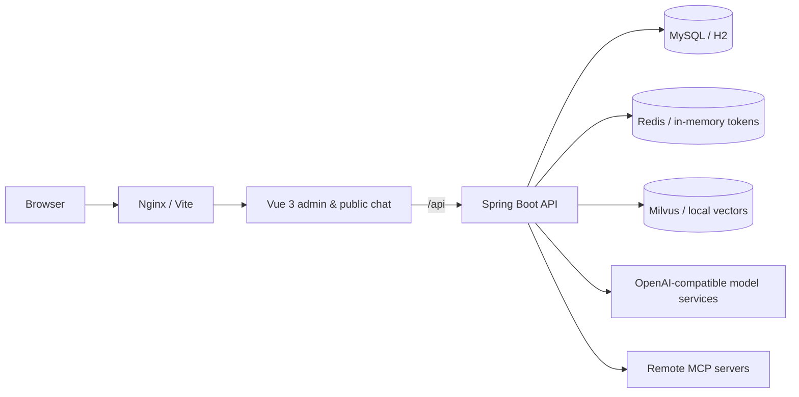

# King AI Platform

A from-scratch AI Agent platform inspired by the product shape and architecture of xxl-ai. It covers business workspaces with RBAC, model supplier onboarding, agent orchestration and release governance, SSE streaming chat, knowledge-base RAG, MCP tools, skills, conversation management, and an admin console.

Front-end and back-end are separated, with two ways to run:

- Zero-dependency local mode: H2 file database + in-memory tokens + local vector index + a built-in Mock model. No MySQL, Redis, Milvus, or model API key required.
- Production stack: MySQL 8 + Redis 7 + Milvus 2.5, started with a single Docker Compose command.

## Feature Overview

- **Workspaces & RBAC**: tenant isolation via `X-Space-Id`; per-space roles `OWNER / ADMIN / EDITOR / VIEWER / AUDITOR`. Admins can switch across all spaces; regular users only see authorized ones. Space and agent deletion uses archive semantics (`deleted_at`) so sessions, messages, audit logs and usage ledgers are never cascade-deleted.
- **Suppliers & models**: unified OpenAI-compatible protocol for chat and embedding models; API keys are AES-GCM encrypted at rest and masked in responses; connectivity tests and model-list import are supported.
- **Agent orchestration**: pick a model, write system prompts and parameters, bind knowledge bases / MCP services / skills; supports publish, unpublish and public access IDs.
- **Release governance**: each release is an immutable snapshot; supports approval submission, four-eyes review, eval cases with a minimum-score gate, percentage-based canary rollout, official release and rollback. With `release.require-approval=false`, submission publishes immediately.
- **Streaming chat**: SSE emits reasoning, content, tool calls, tool results, knowledge citations and token usage; generation can be stopped and content is persisted incrementally.
- **Knowledge-base RAG**: text and file import (TXT / Markdown / PDF / PNG / JPG); chunking respects paragraph and sentence boundaries; asynchronous embedding. Text PDFs are extracted directly; scanned PDFs and images go through Tesseract OCR when enabled. Retrieval is injected into the conversation context with citations. Uploaded payloads are verified against their declared type via magic-byte checks before parsing.
- **MCP tools**: connects to remote MCP servers over Streamable HTTP and JSON-RPC 2.0, auto-discovers tools and participates in multi-round tool calling; supports no-auth and OAuth 2.0 client-credentials modes with automatic token acquisition and refresh.
- **Identity & access**: local accounts with BCrypt passwords and TOTP two-factor auth (including recovery codes); optional OIDC single sign-on that maps IdP role claims onto space roles.
- **SKILL skills**: `SKILL.md` is the locked core, with directory trees and reference files; the skill spec is injected into the system prompt and the model can call `skill_read_file` on demand.
- **Conversation management**: admins browse all sessions and messages with source filters, keyword search and rename; public chats isolate sessions per browser visitor.
- **UI themes**: light, dark and system modes, remembered in the browser.
- **Compliance & audit**: per-space content moderation, PII masking, retention policies and legal hold; data export, access reviews and audit-log search, with sensitive operations fully traced.
- **Usage & cost (FinOps)**: every conversation records input/output tokens and estimated cost into an append-only space ledger; spaces can set a monthly token quota that returns 429 when exhausted.
- **Public chat pages**: published agents are reachable without login at `/#/chat/{publicId}`, protected by a server-signed visitor cookie, per-minute rate limiting and per-space concurrency quotas.
- **Private/on-prem delivery**: Docker Compose, Helm Chart and an air-gapped offline bundle (images, chart, migration SQL, license tooling); Ed25519 offline licenses enforce per-space / per-user / per-agent capacity limits.
- **Security design**: opaque token sessions, BCrypt passwords, login-failure protection, TOTP MFA, signed OIDC state/nonce, DOMPurify-sanitized Markdown, per-hop outbound URL validation, optional bearer token for non-health actuator endpoints, and minimal field exposure on public APIs.

## Tech Stack

| Layer | Technology |
| --- | --- |
| Backend | Spring Boot 3.5, Java 17+, MyBatis-Plus, Flyway, OkHttp |
| Data | H2 (local) / MySQL 8 (production), Redis 7, Milvus 2.5 |
| Frontend | Vue 3.5, TypeScript, Vite, Pinia, Vue Router, Element Plus |
| Rendering | marked + DOMPurify + highlight.js |
| Delivery | Docker multi-stage builds, Nginx, Docker Compose, Helm |

## Architecture



Main conversation pipeline:

```text
User message
  -> auth & space check
  -> session create / history trimming
  -> knowledge retrieval & citations
  -> SKILL.md injected into system prompt
  -> MCP tool discovery & assembly
  -> streaming model generation (multi-round tool calls)
  -> SSE push + incremental persistence
  -> completion / stop / failure finalization
```

See [docs/architecture.md](docs/architecture.md) (Chinese) for the full design.

## Repository Layout

```text
King-AI-Platform/
├── pom.xml                    # Maven aggregator
├── docker-compose.yml         # MySQL / Redis / Milvus / API / UI
├── .env.example               # Deployment environment template
├── king-ai-api/               # Spring Boot backend
│   ├── Dockerfile
│   └── src/main/
│       ├── java/com/king/ai/
│       │   ├── agent/         # Agent orchestration & public info
│       │   ├── audit/         # Audit log write, query & purge
│       │   ├── auth/          # Login, tokens, login protection
│       │   ├── chat/          # SSE chat runtime & sessions
│       │   ├── common/        # Responses, exceptions, security, crypto
│       │   ├── compliance/    # Moderation, retention, legal hold, export, access review
│       │   ├── config/        # Configuration, runtime wiring, demo bootstrap
│       │   ├── finops/        # Usage ledger, price book, monthly quotas
│       │   ├── knowledge/     # Knowledge bases, chunking, vector stores
│       │   ├── license/       # Offline license & capacity checks
│       │   ├── llm/           # OpenAI-compatible client & Mock
│       │   ├── mcp/           # MCP client & service management
│       │   ├── model/         # Suppliers & models
│       │   ├── observability/ # Chat, retrieval, MCP metrics & traces
│       │   ├── skill/         # Skills & file trees
│       │   ├── sso/           # OIDC login & role mapping
│       │   └── system/        # Users & spaces
│       └── resources/
│           ├── application.yml
│           ├── application-local.yml
│           ├── application-prod.yml
│           └── db/migration/{h2,mysql}
├── king-ai-ui/                # Vue 3 frontend
│   ├── Dockerfile
│   ├── nginx.conf
│   └── src/
│       ├── api/
│       ├── components/
│       ├── pages/
│       ├── router/
│       ├── stores/
│       ├── styles/
│       └── utils/
├── mcp-test-server/           # Python Streamable HTTP MCP test server
├── mcp-spring-server/         # Spring Boot Streamable HTTP MCP test server
├── loadtest/                  # SSE & RAG load scripts and baselines
├── deploy/                    # Compose overlays, Helm, backup & air-gap tooling
└── docs/                      # Architecture, deployment & operations manuals
```

## Quick Start (Local)

Requirements: JDK 17+, Maven 3.9+, Node.js 20.19+ (22/24 recommended).

### 1. Start the backend

```bash
mvn -q -pl king-ai-api -am package -DskipTests
cd king-ai-api
java -jar target/king-ai-api.jar --spring.profiles.active=local
```

The local profile defaults to:

- H2 file database: `king-ai-api/data/kingai`
- In-memory token store
- Local vector index
- Built-in Mock model
- Port `8081` (avoids clashes with common 8080 services)

Health check: <http://localhost:8081/api/health>

### 2. Start the frontend

```bash
cd king-ai-ui
npm install
npm run dev
```

Open <http://localhost:5173>. The dev server proxies `/api` to `http://localhost:8080` by default; since the local backend listens on `8081`, point the proxy at it:

```bash
VITE_API_PROXY=http://localhost:8081 npm run dev
```

### 3. Sign in and explore

- Username: `admin`
- Password: `admin123` (local demo profile only; production must create the initial admin via environment variables)

Seeded demo data includes:

- Workspace `King AI Demo Space`
- Mock supplier, chat model and 256-dim embedding model
- A knowledge base with the indexed document "King AI Platform Overview"
- Skill "Product Q&A Guidelines" with reference files
- Demo MCP server (time and echo tools)
- Published public agent "King Assistant": <http://localhost:5173/#/chat/demo-agent>

Suggested walkthrough:

1. Check the workspace overview on the dashboard.
2. In chat test, ask "What are King AI's core capabilities?" and watch streaming plus citations.
3. Ask "What time is it now?" to see the MCP tool-call card.
4. Import a document into the knowledge base, rebuild the index, then verify citations in chat.
5. Edit an agent's system prompt, bind knowledge bases / MCP / skills and publish.
6. Open the public chat page in an incognito window to verify visitor isolation.
7. Filter conversation records by source and keyword, and inspect full messages.

## Docker Compose Deployment

Requirements: Docker 24+, Docker Compose v2; 4+ CPU cores and 8 GB RAM recommended.

### 1. Prepare environment variables

```bash
cp .env.example .env
```

At minimum:

- Generate `KING_AI_SECRET` with `openssl rand -hex 32`
- Change the MySQL, Redis and MinIO passwords
- Set `KING_AI_DEMO_ENABLED=true` for the full demo stack

### 2. Start

```bash
docker compose up -d --build
docker compose ps
docker compose logs -f api
```

First start pulls images and waits for Milvus; expect 1–3 minutes. Flyway creates the schema on first MySQL init; production migrations exclude demo seed data.

Endpoints:

- Admin UI: <http://localhost>
- Backend health: <http://localhost:8080/api/health>
- Public chat: <http://localhost/#/chat/demo-agent> (only when `KING_AI_DEMO_ENABLED=true` with demo data)

The admin account is created on first boot from `KING_AI_ADMIN_USERNAME` / `KING_AI_ADMIN_PASSWORD`; the password must be changed at first login.

### 3. Data & cleanup

MySQL, Redis, etcd, MinIO and Milvus persist in named volumes.

```bash
docker compose down          # stop, keep data
docker compose down -v       # stop and delete all volumes (irreversible)
```

### Demo switch

`KING_AI_DEMO_ENABLED=true` registers the built-in demo MCP endpoint and re-indexes seeded documents on startup. When `false`:

- `/api/demo/**` is not registered;
- seeded knowledge docs stay `PENDING` until manually re-indexed;
- the demo agent's MCP tools become unavailable.

Disable the demo switch in production and replace sample resources with your own model suppliers.

## Configuration

Key environment variables:

| Variable | Default | Description |
| --- | --- | --- |
| `KING_AI_SECRET` | none (required by Compose) | Session & visitor-cookie signing secret, ≥32 random chars |
| `KING_AI_ENCRYPTION_KEY` | none (required by Compose) | AES-GCM key for API keys, MCP credentials etc.; must differ from `KING_AI_SECRET` |
| `KING_AI_PREVIOUS_ENCRYPTION_KEYS` | empty | Comma-separated retired keys used to decrypt old data during rotation |
| `MYSQL_HOST` / `MYSQL_PORT` | `mysql` / `3306` | MySQL address |
| `MYSQL_DATABASE` | `king_ai` | Database name |
| `MYSQL_USER` / `MYSQL_PASSWORD` | `king` / `king_ai_password` | Business DB account |
| `REDIS_HOST` / `REDIS_PORT` | `redis` / `6379` | Redis address |
| `REDIS_PASSWORD` | `king_ai_redis` | Redis password |
| `MILVUS_URL` | `http://milvus:19530` | Milvus endpoint |
| `MILVUS_TOKEN` | empty | Milvus token (empty when auth is disabled) |
| `MILVUS_BIND` | `127.0.0.1` | Host interface the Milvus port binds to; widen only if external tools must reach it |
| `MILVUS_COLLECTION_MODE` | `shared` | Shared collections (per-dimension, partitioned by space) or legacy `per-kb` layout |
| `MILVUS_COLLECTION_PREFIX` / `MILVUS_PARTITIONS_NUM` | `king_ai_chunks_v2` / `64` | Shared-collection prefix and partition count (immutable after creation) |
| `KING_AI_DEMO_ENABLED` | `false` | Enable demo MCP and auto-indexing |
| `KING_AI_MANAGEMENT_TOKEN` | empty | Bearer token guarding non-health actuator endpoints (prometheus, info); send as `X-Actuator-Token` or `Authorization: Bearer` |
| `KING_AI_RELEASE_REQUIRE_APPROVAL` | `true` | Whether releases require approval; off = submit-and-publish |
| `KING_AI_RELEASE_EVAL_PASS_SCORE` | `0.8` | Minimum weighted eval score before approval |
| `KING_AI_RELEASE_MAX_EVAL_CASES` / `_EVAL_MAX_TOKENS` | `20` / `512` | Per-agent eval case cap and per-run token cap |
| `KING_AI_SSO_ENABLED` | `false` | Enable OIDC single sign-on |
| `KING_AI_OIDC_ISSUER` / `_CLIENT_ID` / `_CLIENT_SECRET` / `_REDIRECT_URI` | empty | OIDC provider, client and callback; enabled when issuer/client-id/redirect are set, confidential clients also need the secret |
| `KING_AI_OIDC_ROLE_CLAIM` | `roles` | Claim carrying space roles; supports `ROLE` or `space-code:ROLE` |
| `KING_AI_OIDC_DEFAULT_SPACE_CODE` / `_DEFAULT_ROLE` | empty / `VIEWER` | Default space & role granted at first login |
| `KING_AI_MFA_ENABLED` | `true` | Allow users to enable TOTP two-factor auth |
| `KING_AI_MFA_ISSUER` | `King AI Platform` | Issuer shown in authenticator apps |
| `KING_AI_OCR_ENABLED` | `false` | Enable Tesseract OCR for scanned PDFs and images |
| `KING_AI_OCR_COMMAND` / `_LANGUAGES` | `tesseract` / `chi_sim+eng` | OCR binary and language packs |
| `KING_AI_OCR_MAX_PAGES` / `_TIMEOUT_SECONDS` / `_RENDER_DPI` | `30` / `120` / `200` | OCR page cap, per-page timeout and PDF render DPI |
| `KING_AI_LICENSE_ENABLED` | `false` | Enable Ed25519 offline license; invalid license refuses startup |
| `KING_AI_LICENSE_FILE` / `_PUBLIC_KEY` | empty | License file path and public key (PEM or Base64) |
| `KING_AI_API_IMAGE` / `KING_AI_UI_IMAGE` | empty | Image refs used by Compose for air-gapped imports |
| `PUBLIC_RATE_LIMIT_PER_MINUTE` | `20` | Per-visitor per-minute cap on public chat |
| `KING_AI_CHAT_MAX_CONCURRENT_PER_SPACE` | `4` | Concurrent chat streams per space; `0` = unlimited |
| `KING_AI_FINOPS_QUOTA_ENABLED` | `true` | Block chat when the space monthly token quota is exhausted |
| `KING_AI_FINOPS_CURRENCY` | `USD` | Currency recorded in the usage ledger |
| `KING_AI_FINOPS_DEFAULT_INPUT_PRICE` / `_OUTPUT_PRICE` | `0` | Default per-million-token prices when no model-specific price is set |
| `API_PORT` / `UI_PORT` | `8080` / `80` | Host ports exposed by Compose |
| `API_BIND` / `MILVUS_BIND` | `127.0.0.1` | Host interfaces for the API and Milvus ports |
| `JAVA_OPTS` | `-XX:MaxRAMPercentage=75` | JVM flags |

Additional Spring properties can be overridden via environment variables, e.g.:

- `KING_AI_CHAT_MAX_TOOL_ROUNDS`: max tool-call rounds
- `KING_AI_CHAT_MAX_INPUT_CHARS`: max input length
- `KING_AI_RAG_MIN_SCORE`: retrieval similarity threshold
- `KING_AI_SESSION_TTL`: session lifetime

List endpoints accept `page` / `size` (default `1` / `20`, max `200`) and return `total`, `totalPages`, `hasNext`, `hasPrevious`. Workspace stats come from `GET /api/workspace/stats` instead of pulling full lists.

Usage & quota APIs: `GET /api/finops/usage` returns the space's current-month tokens, estimated cost, per-model breakdown and the latest 20 records; `PUT /api/finops/quota` (space `OWNER` only) sets `monthlyTokenQuota` (`0` = unlimited). Per-model prices live under `king-ai.finops.prices` keyed by model id, falling back to the defaults; price changes only affect records written afterwards.

Enterprise capability notes:

- **SSO**: with `KING_AI_OIDC_*` configured, the login page shows an SSO entry; register `https://<your-domain>/api/auth/oidc/callback` as the IdP callback. Role claims accept `ADMIN` or `space-code:EDITOR`; misses fall back to `KING_AI_OIDC_DEFAULT_SPACE_CODE` and the default role.
- **MFA**: bind TOTP under "Account Security"; recovery codes are shown once. Once enabled, password login also requires the OTP. Disable globally with `KING_AI_MFA_ENABLED=false`.
- **Release governance**: maintain eval cases in the agent edit drawer; `Submit for release` enters approval; after approval you can set a canary percentage, then release officially or roll back. Set `KING_AI_RELEASE_REQUIRE_APPROVAL=false` to restore submit-and-publish.
- **OCR**: the API image ships `tesseract` with `chi_sim` / `eng` packs; bare-metal installs must provide them. Set `KING_AI_OCR_ENABLED=true` to import scanned PDFs and PNG/JPG.
- **License & air-gap**: signature and file format in [deploy/airgap/license/README.md](deploy/airgap/license/README.md) (Chinese); offline delivery flow in [deploy/airgap/README.md](deploy/airgap/README.md) (Chinese); inspect capacity via `GET /api/license`.

For deployment, auth, backup and troubleshooting details see [docs/DEPLOYMENT.md](docs/DEPLOYMENT.md) (Chinese).

## Chat SSE Protocol

Admin endpoint: `POST /api/chat/send` — requires the login cookie (or Bearer token) and `X-Space-Id`.

Public endpoint: `POST /api/public/chat/send` — requires the server-issued visitor cookie; the first call to `GET /api/public/chat/sessions` issues one automatically.

Event stream:

```text
event: meta          requestId, sessionId, agentId, model
event: citation      knowledge citation (index, doc name, snippet, score)
event: reasoning     reasoning deltas
event: content       content deltas
event: tool_call     tool call start (name, args, source)
event: tool_result   tool call result (result, latency, error)
event: tool_approval write tool awaiting human approval (continue after approve/deny)
event: usage         prompt / completion token stats
event: done          messageId, sessionId, status, duration
event: error         generation failure (still followed by done)
event: retry         transient model failure retry notice
event: degraded      fallback to a degraded model after primary failure
event: heartbeat     keep-alive, safe to ignore
```

The frontend reads the stream via `fetch`; the stop button cancels the in-flight request. SSE connections last up to 600s with a 15s heartbeat.

## Security Notes

- Production must set independent `KING_AI_SECRET`, `KING_AI_ENCRYPTION_KEY` and a strong admin password; the app refuses to start otherwise.
- Supplier API keys, MCP headers / OAuth client secrets and TOTP secrets are AES-GCM encrypted at rest; APIs return masked values only; the OAuth client secret is write-only.
- Sessions use opaque server-side tokens carried in an `HttpOnly` cookie; local uses memory, production uses Redis. MFA accounts get a short-lived challenge after password check — a session is only created after TOTP or a recovery code verifies.
- OIDC uses the authorization-code flow: state and nonce are signed with the platform key and time-limited; the callback validates the ID token signature, issuer, audience and nonce; role claims can only elevate space permissions, never downgrade existing roles.
- Licenses are Ed25519-signed and verified against the public key at startup; with `KING_AI_LICENSE_ENABLED=true`, an invalid, expired or missing license refuses startup.
- OCR runs as a local Tesseract subprocess with timeouts, output caps and temp-file cleanup; failures are isolated per page. Enable only on trusted hosts with `tesseract` and language packs installed.
- Public endpoints expose only the agent name, description, public ID and capability tags — never system prompts, model config or secrets.
- Markdown is sanitized with DOMPurify before rendering; external links get `noopener noreferrer`.
- Public chat uses an HMAC-signed visitor cookie with rate limits keyed on visitor + source IP; stop and tool-approval endpoints verify request ownership. Multi-instance deployments share rate limits and concurrency quotas via Redis.
- Uploaded files are checked against magic bytes matching their declared extension before reaching the PDF/OCR parsers; text uploads containing NUL bytes are rejected as binary.
- Outbound URLs block private networks and cloud metadata addresses by default; allowlist precise hosts via `KING_AI_ALLOWED_OUTBOUND_HOSTS`.
- Set `KING_AI_MANAGEMENT_TOKEN` to require a bearer token on `/actuator` endpoints other than `health` (prometheus, info); Prometheus scrapes can pass it via `credentials_file` (see `deploy/observability/prometheus/prometheus.yml`).
- Terminate TLS at Nginx or the cloud LB and expose only the UI and API ports; keep MySQL, Redis and Milvus internal-only.

## Build & Verify

```bash
# Backend compile, unit tests and package
mvn -B clean verify

# MySQL 8 integration tests: migrations, tenant isolation, session ownership
# (requires Docker; Testcontainers starts MySQL automatically)
mvn -B -pl king-ai-api -am test -Dtest=MySqlMigrationTest -DfailIfNoTests=false

# Frontend checks: lint, unit tests, typecheck and production build
cd king-ai-ui
npm ci
npm run lint
npm test
npm run build

# End-to-end tests (first run: npx playwright install chromium)
npm run test:e2e
```

CI (`.github/workflows/ci.yml`) runs:

- Backend `mvn verify` with archived test reports
- A dedicated MySQL 8 job: Testcontainers integration tests (migrations, tenant isolation, session ownership)
- Frontend ESLint, Vitest, typecheck, production build, Playwright e2e and `npm audit`
- Trivy dependency, secret and config scanning, plus a CycloneDX SBOM
- API & UI container image builds
- PR dependency review
- Weekly Dependabot updates for Maven, npm, Docker and GitHub Actions (`.github/dependabot.yml`)

## Known Boundaries

- The local vector store and in-memory token store are for single-instance development only; production requires Milvus and Redis.
- Milvus defaults to shared collections (split by embedding dimension, `space_id` partition key); switching from the legacy `per-kb` layout requires re-indexing existing knowledge bases.
- Space and agent deletion is archival; archived rows and their history are retained indefinitely with no UI restore or purge path, and space codes stay occupied after archiving. Reusing a code or purging data is a DBA/compliance operation.
- The local vector store scans pages and keeps a Top-K heap; per-query scan is capped by `king-ai.local-vector.max-scan` (default 200k rows) — dev/demo only.
- Knowledge parsing supports TXT, Markdown, PDF and PNG/JPG; OCR depends on `tesseract` and language packs on the host or in the image, is off by default, and scanned files beyond `max-pages` must be split before upload.
- Release approval is a single-level four-eyes review: submitter ≠ approver; canary uses fixed percentages — no scheduled ramp-up, metric-based promotion or auto-rollback yet. Eval is keyword-hit weighted scoring, not a full quality assessment.
- SSO implements only the OIDC authorization-code flow with role-claim mapping; no SCIM sync, SAML or IdP-initiated logout. MFA supports TOTP and one-time recovery codes only.
- Quota checks read current-month usage at request start — an approximate pre-check: concurrent requests may all pass, suited to preventing runaway spend rather than exact enforcement.
- Costs are estimates from configured unit prices; supplier invoices remain authoritative. Price changes only affect subsequently written records.
- The air-gap bundle contains container images, the Helm chart, Compose files, migration SQL and license tooling — not OS package mirrors; OCR and other system dependencies must be baked into base images or installed on target hosts.
