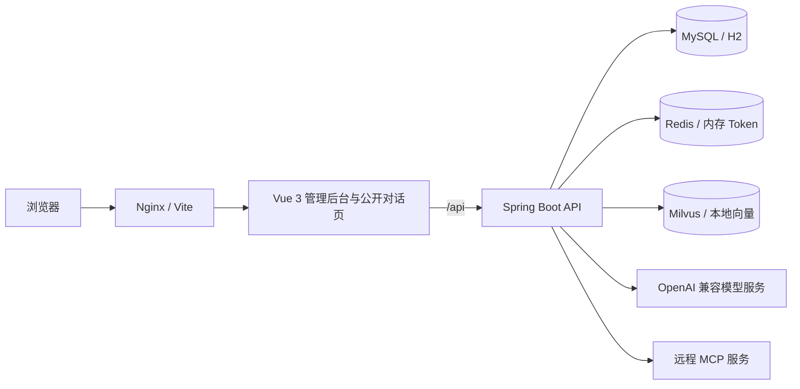

# King AI Platform

一个从零实现的 AI Agent 平台，参考 xxl-ai 的产品形态与架构思路，覆盖业务空间与权限、模型供应商接入、智能体编排与发布、SSE 流式对话、知识库 RAG、MCP 工具、SKILL 技能、会话记录与管理后台。

前后端分离，支持两种运行方式：

- 本地零依赖：H2 文件数据库 + 内存 Token + 本地向量索引 + Mock 模型，不需要 MySQL、Redis、Milvus 或任何模型 API Key。
- 生产栈：MySQL 8 + Redis 7 + Milvus 2.5，通过 Docker Compose 一键启动。

## 功能概览

- 空间与 RBAC：业务空间隔离数据，通过 `X-Space-Id` 控制上下文；空间内支持 `OWNER / ADMIN / EDITOR / VIEWER / AUDITOR` 角色，管理员可切换全部空间，普通用户仅能访问被授权空间。
- 供应商与模型：统一 OpenAI 兼容协议，支持对话模型与嵌入模型；API Key 使用 AES-GCM 加密存储并掩码展示；支持连通性测试与模型列表导入。
- 智能体编排：选择模型、填写系统指令与参数、绑定知识库 / MCP 服务 / 技能，支持发布、取消发布与公开访问 ID。
- 流式对话：SSE 输出思考过程、正文、工具调用、工具结果、知识引用与 Token 用量；支持停止生成，生成内容持续落库。
- 知识库 RAG：文本与文件导入（TXT / Markdown / PDF），按段落和句子边界分片，异步向量化；对话前自动检索并注入上下文与引用。
- MCP 工具：基于 Streamable HTTP 与 JSON-RPC 2.0 连接远程 MCP 服务，自动发现工具并参与多轮工具调用。
- SKILL 技能：以锁定的 `SKILL.md` 为核心，支持目录树与参考文件；技能规范注入系统提示词，模型可按需调用 `skill_read_file` 读取其他文件。
- 会话管理：管理端查看全量会话与消息、来源筛选、关键字搜索、重命名；公开对话按浏览器访客隔离会话。
- 合规与审计：按空间配置内容审核、PII 脱敏、留存策略与法律保留；支持数据导出、访问复核与审计日志检索，敏感操作全程留痕。
- 公开对话页：发布后的智能体可通过 `/#/chat/{publicId}` 免登录访问，使用服务端签名的访客 Cookie、分钟级限流与空间并发配额。
- 安全设计：不透明 Token 登录态、BCrypt 密码、登录失败保护、Markdown XSS 净化、出站 URL 逐跳校验、公开接口最小化字段暴露。

## 技术栈

| 层 | 技术 |
| --- | --- |
| 后端 | Spring Boot 3.5、Java 17+、MyBatis-Plus、Flyway、OkHttp |
| 数据 | H2（本地）/ MySQL 8（生产）、Redis 7、Milvus 2.5 |
| 前端 | Vue 3.5、TypeScript、Vite、Pinia、Vue Router、Element Plus |
| 渲染 | marked + DOMPurify + highlight.js |
| 部署 | Docker 多阶段构建、Nginx、Docker Compose |

## 架构



对话主链路：

```text
用户消息
  -> 鉴权与空间校验
  -> 会话创建 / 历史裁剪
  -> 知识库检索与引用
  -> SKILL.md 注入系统提示词
  -> MCP 工具发现与装配
  -> 模型流式生成（可多轮工具调用）
  -> SSE 推送 + 增量落库
  -> 完成 / 停止 / 失败状态收尾
```

更完整的设计说明见 [docs/architecture.md](docs/architecture.md)。

## 目录结构

```text
King-AI-Platform/
├── pom.xml                    # Maven 聚合工程
├── docker-compose.yml         # MySQL / Redis / Milvus / API / UI
├── .env.example               # 部署环境变量模板
├── king-ai-api/               # Spring Boot 后端
│   ├── Dockerfile
│   └── src/main/
│       ├── java/com/king/ai/
│       │   ├── agent/         # 智能体编排与公开信息
│       │   ├── audit/         # 审计日志写入、检索与清理
│       │   ├── auth/          # 登录、Token、登录保护
│       │   ├── chat/          # SSE 对话运行时与会话
│       │   ├── common/        # 响应、异常、安全、加密
│       │   ├── compliance/    # 内容审核、留存、法律保留、导出、访问复核
│       │   ├── config/        # 配置、运行时装配、演示引导
│       │   ├── knowledge/     # 知识库、分片、向量存储
│       │   ├── llm/           # OpenAI 兼容客户端与 Mock
│       │   ├── mcp/           # MCP 客户端与服务管理
│       │   ├── model/         # 供应商与模型
│       │   ├── skill/         # 技能与文件树
│       │   └── system/        # 用户与空间
│       └── resources/
│           ├── application.yml
│           ├── application-local.yml
│           ├── application-prod.yml
│           └── db/migration/{h2,mysql}
└── king-ai-ui/                # Vue 3 前端
    ├── Dockerfile
    ├── nginx.conf
    └── src/
        ├── api/
        ├── components/
        ├── pages/
        └── stores/
```

## 本地快速开始

环境要求：JDK 17+、Maven 3.9+、Node.js 20.19+（推荐 22/24）。

### 1. 启动后端

```bash
mvn -q -pl king-ai-api -am package -DskipTests
cd king-ai-api
java -jar target/king-ai-api.jar
```

本地 profile 默认使用：

- H2 文件数据库：`king-ai-api/data/kingai`
- 内存 Token 存储
- 本地向量索引
- 内置 Mock 模型
- 端口 `8081`（避免与常见 8080 服务冲突）

健康检查：<http://localhost:8081/api/health>

### 2. 启动前端

```bash
cd king-ai-ui
npm install
npm run dev
```

访问 <http://localhost:5173>，开发服务器会将 `/api` 代理到 `http://localhost:8081`。

如果后端端口不同，可通过 `VITE_API_PROXY` 指定：

```bash
VITE_API_PROXY=http://localhost:8082 npm run dev
```

### 3. 登录与体验

- 用户名：`admin`
- 密码：`admin123`（仅本地演示 profile；生产环境必须通过环境变量创建初始管理员）

内置演示数据包含：

- 业务空间 `King AI 演示空间`
- Mock 供应商、对话模型、256 维嵌入模型
- 知识库与已索引的《King AI 平台介绍》
- 技能「产品答疑规范」及参考文件
- 演示 MCP 服务（时间与回显工具）
- 已发布的公开智能体「King 助手」：<http://localhost:5173/#/chat/demo-agent>

建议按以下顺序体验：

1. 工作台查看空间概览。
2. 对话测试中提问「King AI 支持哪些核心能力？」，观察流式回答与知识引用。
3. 继续提问「现在几点了？」，观察 MCP 工具调用卡片。
4. 在知识库中导入文档并重建索引，再回到对话测试验证引用。
5. 在智能体中修改系统提示词、绑定知识库 / MCP / 技能并发布。
6. 打开公开对话页，使用无痕窗口验证访客会话隔离。
7. 在对话记录中按来源、关键字筛选并查看完整消息。

## Docker Compose 部署

环境要求：Docker 24+、Docker Compose v2，建议至少 4 核 CPU 与 8 GB 内存。

### 1. 准备环境变量

```bash
cp .env.example .env
```

修改 `.env`，至少完成：

- 使用 `openssl rand -hex 32` 生成并设置 `KING_AI_SECRET`
- 修改 MySQL、Redis、MinIO 密码
- 体验完整演示栈时设置 `KING_AI_DEMO_ENABLED=true`

### 2. 启动

```bash
docker compose up -d --build
docker compose ps
docker compose logs -f api
```

首次启动需要拉取镜像并等待 Milvus 就绪，通常需要 1 到 3 分钟。MySQL 首次初始化时 Flyway 会创建业务表；生产迁移不包含演示种子数据。

访问：

- 管理后台：<http://localhost>
- 后端健康检查：<http://localhost:8080/api/health>
- 公开对话页：<http://localhost/#/chat/demo-agent>（仅当 `KING_AI_DEMO_ENABLED=true` 且使用演示数据时）

管理员账号由 `KING_AI_ADMIN_USERNAME` / `KING_AI_ADMIN_PASSWORD` 在首次启动时创建，首次登录必须修改密码。

### 3. 数据与清理

MySQL、Redis、etcd、MinIO、Milvus 均使用命名卷持久化。

```bash
docker compose down          # 停止并保留数据
docker compose down -v       # 停止并删除全部数据卷（不可恢复）
```

### 演示开关说明

`KING_AI_DEMO_ENABLED=true` 会启用内置演示 MCP 接口，并在启动时自动重建待索引的种子文档。设为 `false` 时：

- `/api/demo/**` 不注册；
- 种子知识文档保持 `PENDING`，需要手动重建索引；
- 种子演示智能体的 MCP 工具不可用。

生产环境建议关闭演示开关，并删除或取消发布演示空间中的示例资源，接入自己的模型供应商。

## 配置项

主要环境变量：

| 变量 | 默认值 | 说明 |
| --- | --- | --- |
| `KING_AI_SECRET` | 无（Compose 必填） | API Key 加密与签名密钥，至少 32 位随机字符 |
| `MYSQL_HOST` / `MYSQL_PORT` | `mysql` / `3306` | MySQL 地址 |
| `MYSQL_DATABASE` | `king_ai` | 数据库名 |
| `MYSQL_USER` / `MYSQL_PASSWORD` | `king` / `king_ai_password` | 业务数据库账号 |
| `REDIS_HOST` / `REDIS_PORT` | `redis` / `6379` | Redis 地址 |
| `REDIS_PASSWORD` | `king_ai_redis` | Redis 密码 |
| `MILVUS_URL` | `http://milvus:19530` | Milvus REST 地址 |
| `MILVUS_TOKEN` | 空 | Milvus Token（未开启鉴权时为空） |
| `KING_AI_DEMO_ENABLED` | `false` | 是否启用演示 MCP 与自动索引 |
| `PUBLIC_RATE_LIMIT_PER_MINUTE` | `20` | 公开对话每访客每分钟请求上限 |
| `KING_AI_CHAT_MAX_CONCURRENT_PER_SPACE` | `4` | 每个空间允许同时运行的对话流数量，`0` 表示不限制 |
| `API_PORT` / `UI_PORT` | `8080` / `80` | Compose 暴露到宿主机的端口 |
| `JAVA_OPTS` | `-XX:MaxRAMPercentage=75` | JVM 参数 |

Spring Boot 配置还可通过环境变量覆盖，例如：

- `KING_AI_CHAT_MAX_TOOL_ROUNDS`：最大工具调用轮次
- `KING_AI_CHAT_MAX_INPUT_CHARS`：单条输入长度上限
- `KING_AI_RAG_MIN_SCORE`：检索相似度阈值
- `KING_AI_SESSION_TTL`：登录态有效期

列表接口统一支持 `page` / `size`（默认 `1` / `20`，上限 `200`），响应包含 `total`、`totalPages`、`hasNext`、`hasPrevious`。工作台统计使用 `GET /api/workspace/stats` 聚合查询，不再拉取全量资源列表。

详细部署、认证、备份与故障排查见 [docs/DEPLOYMENT.md](docs/DEPLOYMENT.md)。

## 对话 SSE 协议

管理端：`POST /api/chat/send`，需要登录 Cookie（或 Bearer Token）与 `X-Space-Id`。

公开端：`POST /api/public/chat/send`，需要服务端签发的访客 Cookie；首次访问 `GET /api/public/chat/sessions` 会自动签发。

事件流示例：

```text
event: meta          requestId、sessionId、agentId、model
event: citation      知识引用（序号、文档名、片段、分数）
event: reasoning     思考过程增量
event: content       正文增量
event: tool_call     工具调用开始（名称、参数、来源）
event: tool_result   工具调用结果（结果、耗时、错误）
event: tool_approval 写操作工具等待人工批准（批准/拒绝后继续）
event: usage         prompt / completion Token 统计
event: done          messageId、sessionId、状态、耗时
event: error         生成失败信息（出现后仍会发送 done）
event: retry         模型瞬态失败后的重试通知
event: degraded      主模型失败后切换降级模型
event: heartbeat     长连接保活，客户端忽略
```

前端通过 `fetch` 读取事件流，支持停止按钮取消正在生成的请求。SSE 连接最长 600 秒，服务端每 15 秒发送心跳。

## 安全说明

- 生产环境必须设置独立的 `KING_AI_SECRET`、`KING_AI_ENCRYPTION_KEY` 与强管理员密码；缺失或不满足强度要求时应用拒绝启动。
- 供应商 API Key 与 MCP 请求头使用 AES-GCM 加密后存储，接口仅返回掩码值。
- 登录态使用服务端不透明 Token，浏览器通过 `HttpOnly` Cookie 携带；本地使用内存实现，生产使用 Redis。
- 公开接口只返回智能体名称、介绍、公开 ID 与能力标签，不暴露系统提示词、模型配置或密钥。
- Markdown 内容经过 DOMPurify 净化后再渲染，外链自动添加 `noopener noreferrer`。
- 公开对话使用 HMAC 签名的访客 Cookie，按「访客 + 来源 IP」限流；停止与工具确认接口会校验请求归属。多实例部署时限流与并发配额使用 Redis。
- 出站 URL 默认拦截内网与云元数据地址，可通过 `KING_AI_ALLOWED_OUTBOUND_HOSTS` 精确放行。
- 建议在 Nginx 或云负载均衡层启用 HTTPS，并仅暴露 UI 与 API 端口，MySQL、Redis、Milvus 保持内网访问。

## 构建与验证

```bash
# 后端编译、单元测试与打包
mvn -B clean verify

# 前端类型检查与生产构建
cd king-ai-ui
npm ci
npm run build
```

CI（`.github/workflows/ci.yml`）包含：

- 后端 `mvn verify` 与测试报告归档
- 前端类型检查、生产构建与 `npm audit`
- Trivy 依赖、密钥与配置扫描，以及 CycloneDX SBOM
- API 与 UI 容器镜像构建
- PR 依赖变更审查

## 已知边界

- 本地向量存储与内存 Token 存储仅适用于单实例开发环境，生产必须使用 Milvus 与 Redis。
- Milvus 当前为每个知识库创建独立 collection，知识库数量很大时应改为共享 collection 加分区字段。
- 本地向量库最多加载 2 万条向量并做内存全量扫描，仅用于开发与演示。
- 知识库文件解析支持 TXT、Markdown 与文本型 PDF，尚未接入 OCR 处理扫描件。
- Agent 发布已支持不可变版本与回滚，但发布审批、灰度发布与自动评测尚未实现。
- 合规能力仍在补齐中：PII/DLP 脱敏、内容审核、法律保留、数据导出与访问复核尚未内置。
- 私有化交付提供 Docker Compose，Helm/K8s、离线镜像包与 air-gap 支持包尚未提供。
