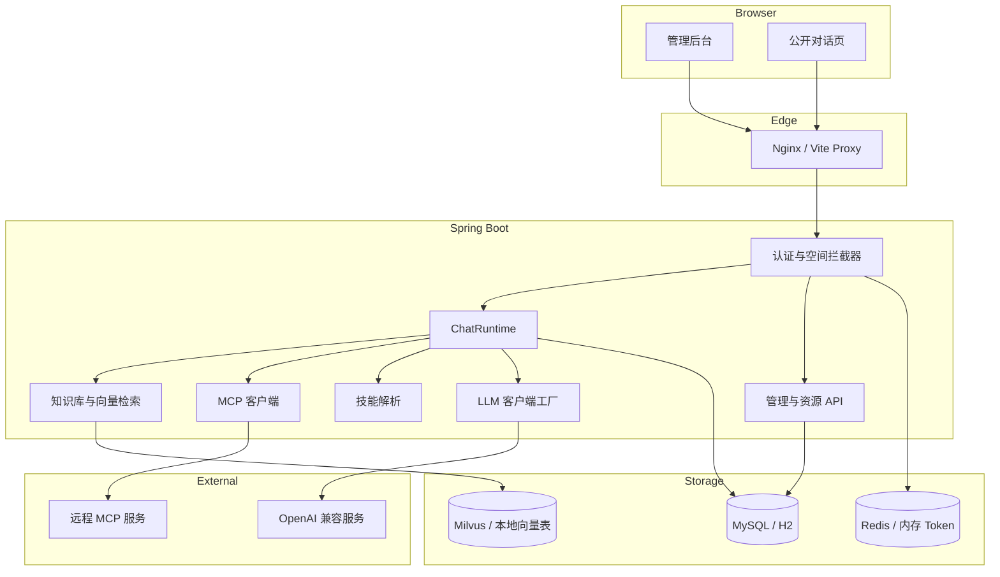
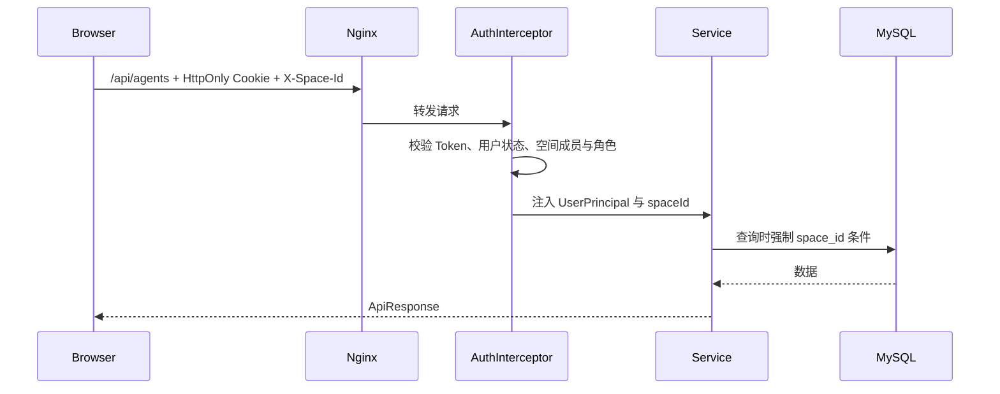
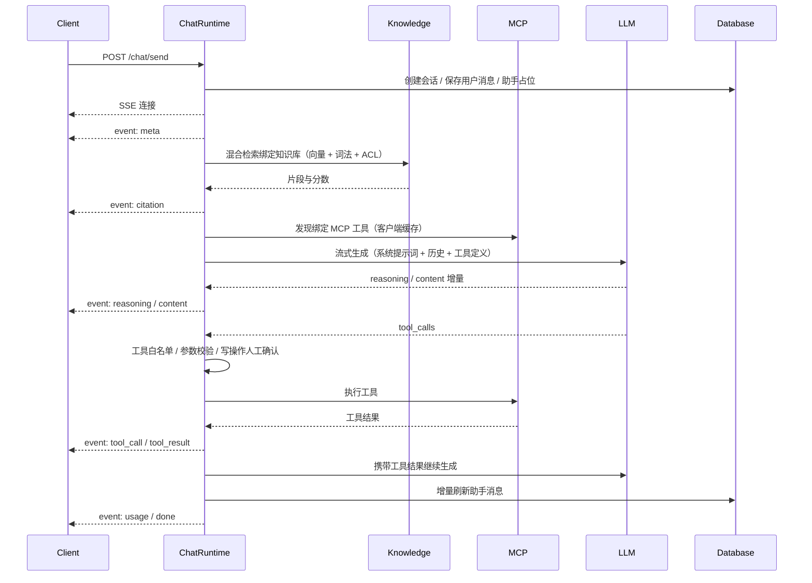
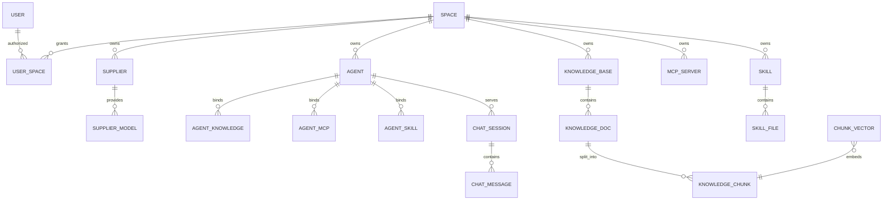
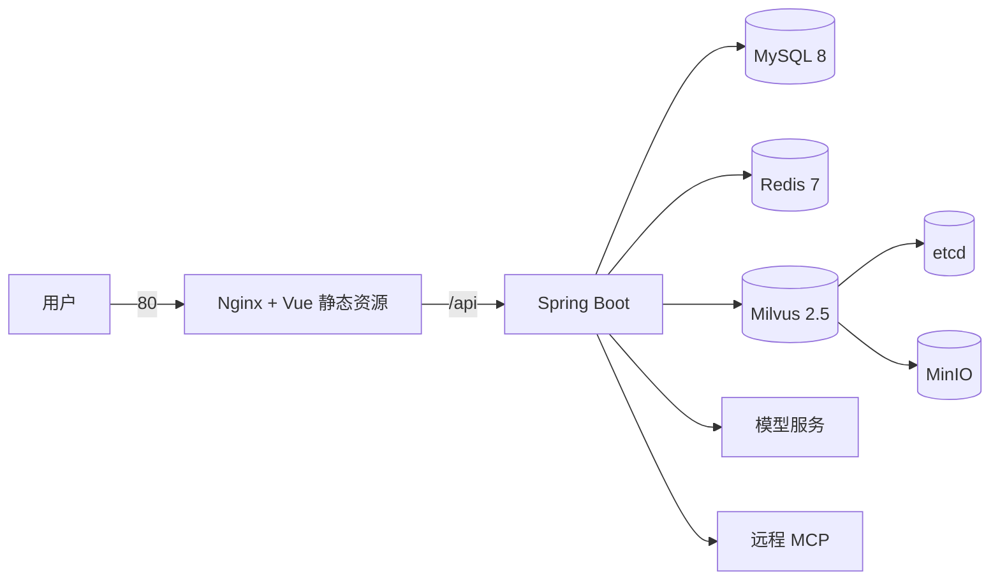

# King AI Platform 架构说明

本文档描述平台的分层、核心链路、数据模型与部署方式，帮助二次开发时快速定位代码。

## 1. 设计目标

- 一套代码同时支持零依赖本地开发与 MySQL / Redis / Milvus 生产部署。
- 智能体是编排中枢：模型、提示词、知识库、MCP 工具与技能围绕智能体组合。
- 对话链路全程可观测：思考过程、工具调用、知识引用、Token 用量与耗时均落库。
- 所有业务数据以空间为边界隔离，鉴权、查询和写入都显式携带空间上下文。
- 外部能力通过稳定接口接入：OpenAI 兼容协议、MCP JSON-RPC、Embedding 接口。

## 2. 系统拓扑



## 3. 后端分层

后端按业务域分包，每个域内保持 Controller -> Service -> Mapper 的依赖方向。

| 包 | 职责 |
| --- | --- |
| `agent` | 智能体 CRUD、绑定关系、发布状态、公开信息 |
| `audit` | 审计日志写入、检索、按保留策略清理与写入失败指标 |
| `auth` | 登录、退出、当前用户、密码修改、Token 存储、登录失败保护 |
| `chat` | SSE 对话运行时、会话与消息、停止注册表、公开对话限流 |
| `common` | 统一响应、异常、加密、请求上下文、拦截器、健康检查、定时任务锁 |
| `compliance` | 内容审核与 PII 脱敏、留存策略、法律保留、数据导出、访问复核 |
| `config` | 配置属性、运行时 Bean、演示数据引导 |
| `finops` | 用量账本、价格表、空间月度 Token 配额与用量查询 |
| `knowledge` | 知识库、文档、分片、Embedding、向量存储适配、检索、OCR 适配 |
| `license` | Ed25519 离线许可证校验、容量统计与执行、许可证状态接口 |
| `llm` | LLM 抽象、OpenAI 兼容客户端、Mock 客户端、工具调用模型 |
| `mcp` | MCP 服务管理、JSON-RPC 客户端、OAuth 令牌管理、演示 MCP 服务 |
| `model` | 供应商与模型配置、模型解析、连通性测试与导入 |
| `skill` | 技能元数据、文件树、锁定的 SKILL.md、参考文件读取 |
| `sso` | OIDC 发现、授权码换取、ID Token 校验、state/nonce 签名与角色映射 |
| `system` | 用户与空间管理、成员授权 |

### 3.1 运行环境适配

以下能力通过 Spring 条件装配在本地与生产间切换：

| 配置 | 本地 | 生产 |
| --- | --- | --- |
| `king-ai.vector-store` | `local`：`LocalVectorStore` | `milvus`：`MilvusVectorStore` |
| `king-ai.token-store` | `memory`：`MemoryTokenStore` | `redis`：`RedisTokenStore` |
| `king-ai.db-type` | `h2` | `mysql` |
| Flyway 路径 | `db/migration/h2` | `db/migration/mysql` |
| 模型供应商 | `MOCK`，确定性文本与向量 | `OPENAI` 兼容服务 |

Mock 模型使用字符二元组哈希生成 256 维确定性向量，并对中文回复做分段流式输出，因此 RAG、引用、工具调用等链路在没有外部模型时也能完整演示。

### 3.2 合规与审计

- 合规设置按空间生效：内容审核支持本地词表、外部审核服务与混合模式，PII 可按内置规则与自定义正则脱敏。
- 留存策略按资源类型（会话、消息、审计、导出）执行，删除前逐条复查法律保留；归档失败的会话不会被删除。
- 数据导出与访问复核通过后台任务执行，导出文件受 TTL 与法律保留约束，下载接口只允许已完成任务；导出存储可在本地卷与 S3 兼容对象存储之间切换（`king-ai.compliance.export.storage`），对象键按空间前缀隔离。
- 审计日志记录操作者、空间、动作、状态与请求 ID；写入失败计数由 `king.ai.audit.write.failures` 暴露并触发告警。
- 留存清理与季度访问复核通过 `JobLock` 抢占跨实例锁，未取得锁的副本跳过本轮，避免重复归档或重复生成复核。

### 3.3 用量账本与配额

- 每次对话结束后向 `king_ai_usage_ledger` 追加一条记录：空间、智能体、会话、助手消息、实际服务模型、输入/输出 Token、估算成本、币种与状态。账本只追加，不随消息删除而回填。
- 成本按 `king-ai.finops.prices` 中「模型 → 每百万 Token 单价」计算，未命中时回退到默认单价；单价变更只影响之后写入的记录，历史记录保持写入时的价格与币种。
- 空间通过 `king_ai_space.monthly_token_quota` 设置月度 Token 配额，`0` 表示不限额。对话开始前读取本月累计用量，达到配额返回 429，并递增 `king.ai.finops.quota_rejected`。
- 配额检查是前置近似判断：并发请求可能同时通过，适用于防止失控花费；它不会回填或阻塞账本写入，账本始终记录真实消耗。
- `GET /api/finops/usage` 返回当月汇总、按模型分布与最近记录；`PUT /api/finops/quota` 仅空间 `OWNER` 可调用，写入审计事件 `finops.quota_update`。

### 3.4 空间与智能体归档

- 删除空间或智能体时只写入 `deleted_at`，对应行不会物理删除；MyBatis-Plus 逻辑删除会让常规查询、详情接口与公开访问自动过滤归档行。
- 删除空间不再触发数据库级联：会话、消息、用量账本、审计日志、法律保留、导出任务以及空间内的供应商、知识库、MCP、技能全部保留，仅移除成员授权；合规证据不会随删除消失。
- 删除智能体不再要求先清空会话；历史会话通过绕过逻辑删除的只读查询继续解析已归档智能体的名称与公开标识，但无法再发起新的对话。
- 已归档空间的公开智能体立即下线；启动引导（`AdminBootstrap`）若发现配置的默认空间已归档，会原地恢复该空间，避免启动失败。
- 空间编码在归档后仍被占用，唯一索引不变；如需复用编码，应由数据库管理员在确认合规要求后手动清理归档行。

### 3.5 发布治理

- 版本状态机：`DRAFT -> PENDING_REVIEW -> APPROVED -> CANARY -> PUBLISHED`，驳回为 `REJECTED`，归档版本为 `ARCHIVED`。每次状态变更都写入不可变 `king_ai_agent_version` 行与审计日志。
- 提交审批生成配置快照（含提示词、模型、绑定与工具白名单）与 `config_hash`；审批通过要求审批人不是提交人，且存在启用用例时最近一次评测达到 `release.eval-pass-score`。
- 评测用例保存在 `king_ai_agent_eval_case`，评测按关键词命中与权重计算得分，结果（总数、通过数、得分、摘要、时间）写回版本行。
- 灰度只允许 `APPROVED` / `CANARY` 版本，比例 1–99；正式发布把版本置为 `PUBLISHED` 并同步智能体 `publish_status` / `published_version`。回滚复用历史版本快照生成新版本。
- `release.require-approval=false` 时提交直接发布；直接调用旧发布接口会返回 409，必须走统一提交通道。

### 3.6 许可证与容量

- `LicenseService` 在启动时读取 `king-ai.license.file`，用 Ed25519 公钥校验签名、许可证 ID、客户与过期时间；启用后任何校验失败都会阻止应用启动。
- 许可证声明 `maxSpaces`、`maxUsers`、`maxAgents` 与特性列表；创建空间、用户（含 SSO 首次登录）与智能体前调用容量检查，超限返回 403。
- `GET /api/license` 仅管理员可访问，返回状态、签发方、有效期、上限、当前用量与特性；未启用时返回 `DISABLED` 且 `limits` 为空。
- 校验为请求前近似判断：并发创建可能同时通过，适合离线交付的容量约束，不替代数据库唯一约束。

## 4. 认证与空间隔离

- 登录成功后生成随机不透明 Token，服务端存储 Token 与用户 ID 的映射，默认有效期 7 天。
- 浏览器通过 `HttpOnly` 会话 Cookie（默认 `king_session`）认证；非浏览器客户端也可使用登录响应中的 `Authorization: Bearer <token>`。
- 客户端通过 `X-Space-Id` 指定当前空间。
- `AuthInterceptor` 解析 Token，校验用户状态与空间成员关系，写入 `RequestContext`；首次登录强制改密时仅放行改密接口并返回 428。
- 管理员可以访问全部空间；普通用户必须存在 `king_ai_user_space` 授权记录。
- 空间角色为 `OWNER / ADMIN / EDITOR / VIEWER / AUDITOR`，写接口通过 `@RequireSpaceRole` 在服务层校验。
- 管理接口通过 `@RequireAdmin` 限制平台管理员。
- 供应商 API Key 与 MCP 请求头使用 AES-GCM 加密存储，读取接口只返回掩码。
- 登录失败按「用户名 + 来源 IP」计数，5 次后锁定 5 分钟，累计 10 次锁 30 分钟、15 次锁 2 小时；同一账号 1 小时内跨 IP 失败 20 次或同一 IP 10 分钟内失败 30 次会分别触发账号/IP 级锁定。
- MFA：启用后密码校验通过只返回短时 `mfaChallenge`（默认 5 分钟）与空用户，调用 `/api/auth/mfa/verify` 校验 TOTP 或一次性恢复码后才签发会话。TOTP 密钥与恢复码哈希使用 AES-GCM 加密存储。
- SSO：`/api/auth/oidc/authorize` 生成带签名 state 与 nonce 的授权跳转；`/api/auth/oidc/callback` 换取 ID Token，校验签名、issuer、audience 与 nonce 后绑定 `king_ai_user_identity`。首次登录可按邮箱合并已有账号或自动创建用户，并受许可证用户容量约束。
- 角色映射：`role-claim` 中的 `ADMIN` 或 `space-code:EDITOR` 会授予对应空间角色；映射只提升不降级，平台管理员账号不受影响。成功后跳转默认 `/#/dashboard`，失败带 `sso_error` 返回登录页。



## 5. 对话运行时

入口：

- 管理端：`POST /api/chat/send`，需要会话 Cookie 与 `X-Space-Id`
- 公开端：`POST /api/public/chat/send`，使用服务端 HMAC 签名的访客 Cookie 识别访客

`ChatRuntime.start` 完成同步校验后，先获取会话级锁与空间并发配额，再将生成任务提交到专用线程池，并立即返回 `SseEmitter`。



关键设计：

- 增量落库：每 800ms 或阶段性节点把新增片段追加到 `king_ai_chat_message_delta`，不再重写整条消息；消息完成后合并为最终内容并清理增量，刷新页面可看到已生成内容。
- 状态收尾：完成、停止、失败三种状态统一在 `finally` 中持久化。
- 停止生成：前端调用 `/requests/{requestId}/stop`，运行时通过 `CancellationToken` 中断流式读取；停止与工具确认均校验会话归属。
- 会话锁与配额：同一会话同时只允许一个生成任务；每个空间默认最多 4 个并发流，超过返回 429，Redis 实现支持多实例共享。
- 工具循环：最多执行 `king-ai.chat.max-tool-rounds` 轮，工具结果按长度截断后回填给模型。
- 工具安全：`allowed_tools` 白名单失败关闭，参数按 JSON Schema 校验，写操作可按 `tool_approval_mode` 进入人工确认，所有调用写入审计。
- 技能工具：除 MCP 工具外，绑定的技能会注入一个只读的 `skill_read_file` 工具，防止模型读取技能目录之外的文件。
- 历史裁剪：按消息条数与字符数双重限制选取历史，避免上下文膨胀。
- 韧性：瞬态 LLM 错误自动重试并回退部分输出，支持降级模型与按模型熔断；`finish_reason=length` 会标记截断。
- 不可信内容：知识片段、技能文本与工具结果均包裹在不可信内容边界中，提示模型只作为数据引用。

SSE 事件由 `ChatRuntime` 统一发送：`meta`、`citation`、`reasoning`、`content`、`tool_call`、`tool_result`、`tool_approval`、`usage`、`done`、`error`、`retry`、`degraded`、`heartbeat`。

## 6. 知识库与 RAG

### 6.1 写入链路

```text
文档导入（文本 / 上传）
  -> 解析文本（TXT、Markdown、PDF）
  -> 扫描件 / 图片：Tesseract OCR（可选，按页渲染与识别）
  -> 按段落与句子边界分片
  -> 创建持久化索引任务（king_ai_knowledge_index_job）
  -> 批量为分片生成向量
  -> 写入向量存储
  -> 更新文档状态与分片数
```

- OCR：文本层字符数低于 `min-text-chars-per-page * pages` 的 PDF 视为扫描件，按 `render-dpi` 渲染每页后调用 `tesseract ... stdout`；支持 PNG / JPG 直接识别。页数超过 `max-pages` 时拒绝上传，单页失败只记录告警，全部失败时回退原始文本层。
- 文档状态：`PENDING`、`PROCESSING`、`READY`、`FAILED`。
- 索引任务由后台 Worker 轮询领取，支持重试、退避、永久失败、超时任务恢复与对账；进程重启不会丢失。
- 向量集合按嵌入维度共享：默认 `king_ai_chunks_v2_<dim>`，包含 `chunk_id`、`doc_id`、`space_id`、`kb_id` 与向量字段。
- 共享集合以 `space_id` 作为分区键，检索与删除都带上 `space_id` 与 `kb_id` 过滤，既做分区裁剪也防止跨空间命中。
- Milvus 使用 `FloatVector` + `AUTOINDEX` + `COSINE`；可用 `king-ai.milvus.collection-mode=per-kb` 回到每知识库一个集合的旧布局。
- 本地向量存储复用 `king_ai_chunk_vector` 表，按 `chunk_id` 分页扫描并用固定大小堆保留 Top-K；`king-ai.local-vector.max-scan` 限制单次扫描行数（默认 20 万），仅适用于开发与演示。

### 6.2 读取链路

1. 对话开始前，根据智能体绑定的知识库分组检索。
2. 同一嵌入模型只对用户问题向量化一次，多个知识库复用查询向量。
3. 向量相似度与词法匹配结果融合，再按文档 ACL 过滤、按合并分数排序并做文档级去重。
4. 按相似度过滤低于 `king-ai.rag.min-score` 的结果。
5. 引用作为 `citation` 事件先推送给前端，同时以不可信内容边界拼接到系统提示词。
6. 系统提示词要求模型基于资料回答，并在证据不足时明确说明。

## 7. MCP 集成

- 传输：Streamable HTTP，JSON-RPC 2.0；配置层拒绝其他传输方式。
- 初始化：`initialize` -> `notifications/initialized` -> `tools/list`。
- 分页：最多读取 10 页工具清单，按名称去重。
- 调用：`tools/call`，提取 `content[].text`，兼容 `structuredContent`，结果超长截断。
- 工具命名：对外暴露为 `mcp{serverId}_{toolName}`，清洗非法字符并保证同名冲突时自动加后缀。
- 会话：客户端保留 `Mcp-Session-Id`，并在后续请求中回传。
- 缓存：按服务地址与配置指纹缓存客户端，配置变更或调用失败时失效，避免每次对话重新 initialize。
- OAuth：`authType=OAUTH2` 时使用客户端凭证模式向 `oauthTokenUrl` 换取令牌，按 `oauthScopes` 请求权限，过期前自动刷新；客户端密钥加密存储且只写不读，配置变更会清空已获取令牌。
- 安全：请求头与 OAuth 密钥加密存储且只回显掩码；工具调用受智能体白名单、参数校验、人工确认与审计约束。

## 8. SKILL 设计

- 每个技能包含若干文件与目录，`SKILL.md` 为锁定文件。
- SKILL.md 允许编辑内容，但不允许改名或删除；这保证技能始终有入口规范。
- 智能体绑定技能后，所有 SKILL.md 按排序拼接注入系统提示词。
- 模型只可通过 `skill_read_file` 读取当前技能下的其他文件，路径越界会被拒绝。
- 文件编辑接口区分内容更新与元数据更新，避免编辑器误改文件类型。

## 9. 数据模型



所有业务表包含 `space_id`（技能文件、消息等通过父表继承空间），查询与写入由服务层强制带上空间条件。会话表额外记录 `source_type`（`ADMIN` / `PUBLIC`）、`owner_user_id` 与 `visitor_id`，用于区分管理端会话与访客会话。Agent 发布使用不可变版本表 `king_ai_agent_version`（记录状态机、提交/审批人、灰度比例、评测结果与配置哈希），评测用例存于 `king_ai_agent_eval_case`；审计日志、索引任务与用量账本 `king_ai_usage_ledger` 分别独立持久化。身份侧新增 `king_ai_user_identity`（OIDC 绑定）与用户表上的 MFA 字段；MCP 服务表增加 OAuth 客户端配置与令牌字段。`king_ai_space` 与 `king_ai_agent` 以 `deleted_at` 实现逻辑删除，历史会话与用量记录因此始终能追溯到已归档的空间和智能体。

## 10. 前端结构

```text
src/
├── api/            # 按域拆分的 HTTP 客户端与类型
├── components/     # 布局、空状态、Markdown、聊天组件
├── pages/          # 登录、概览、智能体、对话、记录、知识库、MCP、技能、模型、合规中心、审计日志、用户、空间、平台许可、公开页
├── stores/         # Pinia：登录态、当前用户、当前空间
├── router/         # Hash 路由与登录守卫
├── utils/          # 时间、文本、格式化
└── styles/         # 设计变量与全局样式
```

- `AppShell` 提供侧边导航、空间切换、管理员菜单与登出。
- `ChatConsole` 同时服务管理端对话测试与公开对话页，内部处理 SSE、停止、会话切换、工具卡片和引用卡片。
- `MarkdownView` 负责 Markdown 渲染、XSS 净化、代码高亮与外链安全属性。
- 公开页不加载管理端布局，仅通过 `/api/public/**` 获取最少信息。

## 11. 部署拓扑



启动顺序由 Docker Compose 健康检查保证：

1. MySQL、Redis、etcd、MinIO 启动并通过健康检查。
2. Milvus 启动并暴露健康端点。
3. API 启动，Flyway 执行 schema 迁移；生产迁移目录不包含演示种子，初始管理员由环境变量创建。
4. UI 在 API 健康后启动。

Nginx 对 `/api/` 关闭代理缓冲并延长读写超时，保证 SSE 增量实时到达浏览器。API 默认绑定 `127.0.0.1`，只通过 UI 反向代理对外提供服务。

## 12. 扩展点

- 新增模型供应商：实现 `LlmClient` 并在 `LlmClientFactory` 中注册，或直接使用 OpenAI 兼容供应商。
- 新增向量后端：实现 `VectorStore`，通过 `king-ai.vector-store` 条件装配。
- 新增登录态存储：实现 `TokenStore`，通过 `king-ai.token-store` 切换。
- 新增对话渠道：复用 `ChatRuntime.start`，传入不同的 `sourceType` 与访客标识。
- 新增对话并发策略：实现 `ChatConcurrencyGuard`，按 `king-ai.token-store` 条件装配内存或 Redis 版本。
- 新增文档解析：扩展知识库上传解析器，保持文本、分片、索引链路不变。
- 新增 MCP 传输：在 `McpClient` 外部增加 stdio 等适配，保持工具抽象不变。

## 13. 安全边界与已知限制

- 本地向量存储为应用内暴力检索，按页扫描并限制单次扫描行数（默认 20 万），不适合生产规模。
- Milvus 共享 collection 以 `space_id` 为分区键、按嵌入维度拆分集合；从旧版每知识库集合切换到共享模式后，需要重新索引已有知识库才能检索到旧向量。
- 内存 Token 存储、限流与并发守卫仅适用于单实例开发；生产使用 Redis 实现。
- OCR 依赖部署环境中的 `tesseract` 与语言包，默认关闭；扫描 PDF 超过 `max-pages` 会被拒绝，OCR 质量取决于语言包与渲染 DPI。
- MCP OAuth 仅支持客户端凭证模式，不覆盖授权码模式、动态客户端注册或按用户授权。
- Agent 发布审批为单级四眼复核，灰度按固定百分比路由；尚不支持定时放量、按指标自动晋级或自动回滚。评测基于关键词命中，不等同于完整质量评估。
- SSO 仅支持 OIDC 授权码流程，不含 SCIM 同步、SAML 或 IdP 单点登出；MFA 仅支持 TOTP 与一次性恢复码。
- 合规能力（PII 脱敏、内容审核、留存策略、法律保留、数据导出、访问复核、审计日志）已内置；Helm Chart 位于 `deploy/helm/king-ai`，air-gap 打包脚本位于 `deploy/airgap`。离线包不含操作系统软件源镜像，OCR 等系统依赖需提前打入镜像。
- 许可证容量为请求前近似判断，并发创建可能同时通过；许可证失效会阻止启动，但运行期过期只在后续容量检查时拒绝。
- 用量账本按请求写入，配额为请求前近似判断，并发请求可能同时通过；成本为按配置单价的估算值，对账仍以供应商账单为准。
