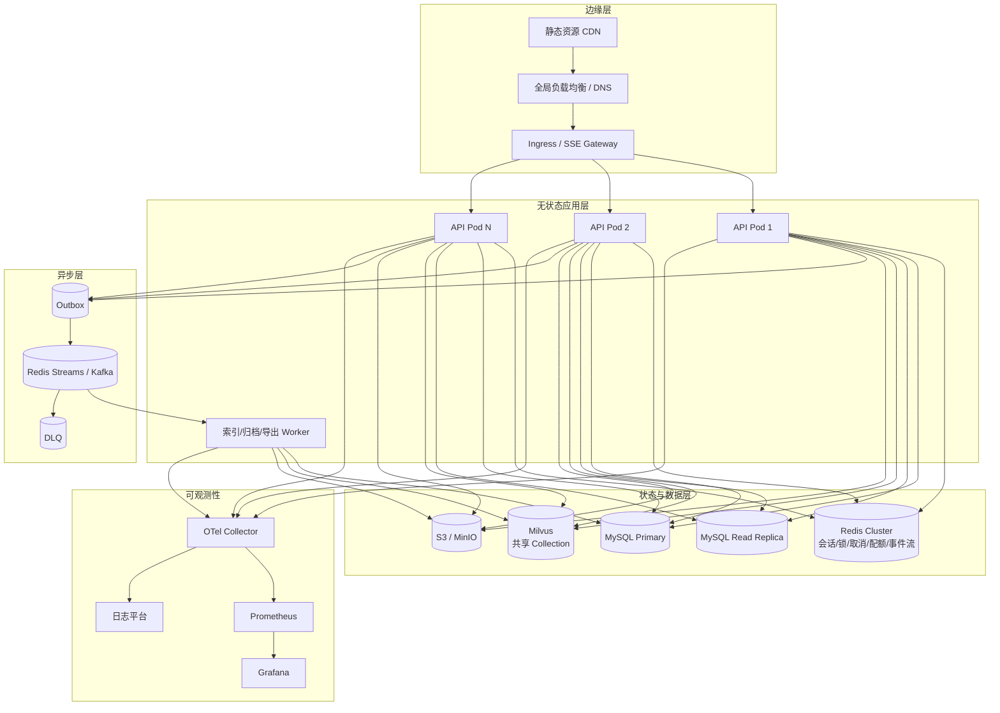
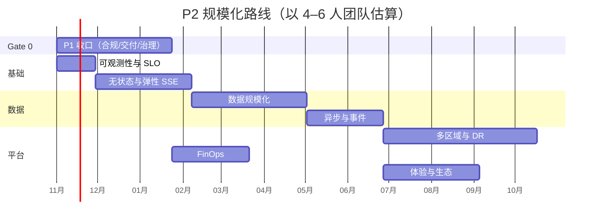

# King AI Platform P2 规模化阶段实施规划

> **For agentic workers:** 本文件是 P2 项目群规划（program plan）。执行时按阶段拆分为独立实现计划，每个子项目使用 `superpowers:writing-plans` 产出可逐任务执行的 plan，再用 `superpowers:executing-plans` 或 `superpowers:subagent-driven-development` 执行。步骤使用 `- [ ]` 复选框跟踪。

**Goal:** 在保持模块化单体边界的前提下，把 King AI Platform 从“可运营的单区域生产系统”推进到“可水平扩展、可容灾、可计量、可私有化交付”的企业级平台。

**Architecture:** 先收口 P1 合规与交付缺口，再按“可观测性 → 无状态化/弹性 SSE → 数据规模化 → 异步事件 → 多区域/DR → FinOps → 体验与生态”的顺序演进。不拆微服务，继续用端口适配器替换基础设施；所有新增状态必须可跨实例、可恢复、可审计。

**Tech Stack:** Java 21、Spring Boot 3.5.x、Spring MVC + SSE、MyBatis-Plus、MySQL 8、Redis 7、Milvus 2.5、S3/MinIO、OpenTelemetry、Prometheus/Grafana、Kubernetes/Helm、Vue 3 + Vite、k6。

**Spec:** `docs/reviews/2026-10-architecture-review.md`（原始架构评审与 P0/P1/P2 定义）、`docs/architecture.md`（当前架构）、`README.md`（已知边界）、本文件第 1 节的验证结论。

---

## 0. 执行摘要

### 0.1 P0/P1 交付验证结论

任务 `532a164c-03ca-4225-b3a3-9dc541bddae8`（“企业级架构分析与改进建议”）交付的 8 项 P0/P1 任务已全部落地，核对中发现的缺陷已修复。关键证据：

| 任务 | 交付 | 证据 | 状态 |
| --- | --- | --- | --- |
| P0-1 空间 RBAC、会话归属、访客身份 | `@RequireSpaceRole`、`SpaceRole`、`ChatSession.ownerUserId`、会话访问校验、HMAC 访客 Cookie、停止接口绑定 actor | `common/security/RequireSpaceRole.java`、`chat/ChatService.java:317`、`chat/VisitorTokenService.java`、`chat/RedisChatCancellationRegistry.java:43` | 完成 |
| P0-2 移除生产演示种子与默认凭据 | 生产 Flyway 不加载演示迁移；管理员由环境变量初始化；首次登录强制改密；启动安全自检 | `application-prod.yml`、`config/AdminBootstrap.java`、`config/StartupSecurityChecks.java`、`db/migration/mysql` | 完成 |
| P0-3 密钥、headers、SSRF、前端安全 | AES-GCM + 密钥版本/轮换、headers 加密且只写、出站 URL 私网/元数据拦截、Cookie 会话、Nginx CSP/HSTS/XFO、SSE 关闭压缩 | `common/CryptoService.java`、`common/web/OutboundUrlGuard.java`、`model/SupplierService.java`、`mcp/McpService.java`、`king-ai-ui/nginx.conf` | 完成 |
| P0-4 Redis 状态与持久化索引 | Redis Token/会话锁/取消/限流/登录保护/并发配额；索引任务表 + claim/retry/DLQ 式永久失败/超时恢复 | `auth/RedisTokenStore.java`、`chat/RedisChatSessionLock.java`、`chat/RedisChatConcurrencyGuard.java`、`knowledge/KnowledgeIndexQueue.java`、`knowledge/KnowledgeIndexWorker.java` | 完成 |
| P0-5 数据库约束、审计、可观测性 | Flyway 外键/唯一键/检查约束/乐观锁/审计字段；审计日志；请求 ID；Actuator/Prometheus；springdoc；ECS 日志 | `db/migration/*/V6__integrity_audit.sql`、`audit/*`、`common/web/RequestIdFilter.java`、`config/StateStoreHealthIndicator.java` | 完成 |
| P1-6 Agent 版本化、Prompt/工具安全、LLM 韧性 | 不可变发布快照/回滚；Prompt 非空；重试/退避/降级/熔断；工具白名单、参数校验、HITL 审批、审计 | `agent/entity/AgentVersion.java`、`agent/AgentService.java`、`llm/LlmCircuitBreaker.java`、`chat/ToolAllowlist.java`、`chat/ToolApprovalRegistry.java` | 完成 |
| P1-7 RAG 质量、分页、前端 | 混合检索 + 词法重排、文档级 ACL、embedding 复用、文档去重；列表分页；工作台统计；前端分页 | `knowledge/KnowledgeAcl.java`、`knowledge/KnowledgeService.java`、`common/PageResult.java`、`king-ai-ui/src/pages/*` | 完成 |
| P1-8 测试、CI、文档、部署 | 9 个测试类 43 个用例；CI 后端/前端/安全/镜像四类 Job；部署、架构、README 更新 | `src/test/java/**`、`.github/workflows/ci.yml`、`docs/DEPLOYMENT.md`、`docs/architecture.md` | 完成 |

验证证据：

- `mvn -B -ntp clean verify`：43 个测试，0 失败、0 错误，构建成功。
- H2 升级路径 V7 → V8 成功，1 个已发布 Agent 回填 1 条不可变版本记录。
- `/api/health` 返回 UP（DB、stateStore）；工作台统计与分页响应结构正确。
- 空间并发配额实测：配额设为 1 时，6 个并发请求得到 1×200 + 5×429；释放后再请求返回 200；`king_ai_chat_rejected_total{reason="space_quota"}=5`，`king_ai_chat_active=0`。
- `npm run build` 成功；`.github/workflows/ci.yml` 与 `docker-compose.yml` 通过本地 YAML 解析（CI 尚未在 GitHub 实际运行）。
- 核对期间修复：熔断器半开状态缺陷、登录失败仅按用户名计数、部署文档指标名错误、知识库文档页响应结构不匹配、H2 升级路径、LLM 历史上下文全量加载（改为数据库侧最近 N 条）。

### 0.2 P1 仍未收口的能力

按 `docs/reviews/2026-10-architecture-review.md` 的 P1 完整清单，以下能力仍未实现。它们不是本次 8 项任务的缺陷，但属于“企业可运营”的必要条件，因此 P2 不能无条件启动，必须先过 **Gate 0**：

| 缺口 | 当前状态 | 风险 |
| --- | --- | --- |
| PII/DLP、内容审核 | 未内置 | 公开对话可能泄露/传播敏感内容 |
| 数据保留、法律保留、导出、访问复核 | 仅有审计日志清理 | 无法满足合规审计与诉讼保全 |
| Helm/K8s、离线镜像、air-gap、备份恢复自动化、迁移 dry-run | 仅 Docker Compose | 私有化交付与灾备不达标 |
| Milvus 共享 collection、OCR | 每 KB 一个 collection；无 OCR | 知识库规模化运维成本高；扫描件不可用 |
| Agent 发布审批、灰度、自动评测 | 有版本化与回滚 | 上线变更缺少四眼原则与质量门禁 |
| Token/成本配额与用量账本 | 仅有并发配额 | 无法做 FinOps 与租户计费 |
| 租户第二道防线（MyBatis 租户插件/RLS） | 服务层显式 `space_id` | 新查询漏条件即可能跨租户泄露 |
| 消息列表分页/归档、对象存储、SDK | 会话列表已分页；消息仍全量返回 | 超长会话与大附件场景性能/成本不可控 |

> **Gate 0 退出标准：** 合规基线（PII/审核/保留/导出/访问复核）、私有化交付（Helm/备份/air-gap）、Agent 发布治理、Milvus 共享 collection、成本账本、租户拦截器六项至少完成并经过演练；消息分页/对象存储可与 P2-3 合并交付。

### 0.3 P2 范围与非目标

**范围：** 虚拟线程与弹性 SSE、读写分离、消息分区/归档、对象存储、多区域/DR、数据驻留、FinOps、i18n/无障碍、插件沙箱与 SDK。

**非目标：**
- 不拆微服务；不引入服务网格作为默认前提。
- 不自研向量数据库、消息队列、计费引擎；优先复用 Milvus、Redis Streams/Kafka、Stripe/Metronome。
- 不做跨区域双写（active-active writes）；写入保持单主，读可多区域。
- 不在 P2 阶段做模型训练/推理平台；继续通过 OpenAI 兼容接口接入模型。

---

## 1. 当前基线与约束

### 1.1 代码与运行基线

- 模块化单体：220 个 Java 源文件，按 `agent/auth/chat/common/config/knowledge/llm/mcp/model/skill/system` 分包。
- 运行形态：Spring MVC + `SseEmitter`；聊天线程池 4/16/100；SSE 超时 600s、心跳 15s；Nginx 关闭代理缓冲。
- 状态：生产使用 Redis（Token、会话锁、取消、限流、登录保护、并发配额）与 MySQL；本地可切 H2/内存。
- 向量：生产 Milvus 每知识库一个 collection；本地表内全量扫描（仅开发）。
- 发布：Agent 不可变版本 + 回滚；公开运行时 fail-closed。
- 测试：9 个测试类、43 个用例；CI 四类 Job；尚无 Testcontainers 集成测试与前端 E2E。

### 1.2 全局约束

- **兼容性：** 现有 REST/SSE 契约保持向后兼容；新增字段只增不改；废弃字段至少保留两个 minor 版本。
- **迁移：** Flyway 前向迁移；生产变更必须支持滚动升级与回滚演练；禁止在业务高峰期做破坏性 DDL。
- **多租户：** 所有读写、事件、缓存键、对象存储路径必须携带 `space_id`；公开端点 fail-closed。
- **安全：** 密钥只经 KMS/Vault/External Secrets 注入；日志与审计不得出现明文凭据/PII；工具与插件默认拒绝。
- **可观测性：** 每个新能力必须暴露指标、结构化日志与审计事件；无指标不上线。
- **测试：** 核心链路必须有单元测试；跨实例/数据库/Redis/Milvus 行为必须有 Testcontainers 集成测试；容量与故障场景必须有压测/混沌演练。
- **SLO 目标：** 单区域可用性 99.9%；多区域 99.95%；API p95 < 300ms；首 token p95 < 2s（不含模型服务自身耗时）；SSE 异常断连率 < 0.5%；RPO ≤ 15min、RTO ≤ 1h。
- **成本：** 每个阶段给出单位请求成本基线；新组件必须说明资源与运维成本。

---

## 2. P2 目标架构



### 2.1 架构原则

1. **模块化单体优先。** 继续按领域分包；只有当某个模块出现独立扩缩容/故障隔离/合规边界需求时才拆服务。P2 默认不拆。
2. **计算无状态。** API Pod 不保存会话、锁、取消、配额、上传文件；全部落 Redis/MySQL/对象存储。
3. **事件驱动只用于跨边界。** SSE 事件、索引、归档、导出、审计通过事件总线；请求内同步逻辑不绕 MQ。
4. **写入单主、读取可扩展。** 多区域不做双写；按租户归属区域路由写入，读走本地副本或主库。
5. **默认拒绝。** 工具、插件、出站网络、跨区域访问都默认拒绝，显式配置才允许。
6. **可回滚。** 每个阶段都有 feature flag、灰度策略、数据回滚/补偿方案。

### 2.2 新增端口与接口

| 端口 | 职责 | 本地实现 | 生产实现 |
| --- | --- | --- | --- |
| `ChatEventPublisher` | 发布/订阅单次对话的 SSE 事件，支持跨实例与断线重放 | `LocalChatEventPublisher` | `RedisStreamChatEventPublisher` / `KafkaChatEventPublisher` |
| `JobQueue` | 通用异步任务：claim、可见性超时、重试、DLQ、幂等 | `DatabaseJobQueue` | `RedisStreamJobQueue` / `KafkaJobQueue` |
| `ObjectStorage` | 文档、导出、归档、插件包 | `LocalObjectStorage` | `S3ObjectStorage`（MinIO/AWS S3/OSS） |
| `SecretProvider` | 应用密钥、供应商 Key、MCP headers | `EnvSecretProvider` | `VaultSecretProvider` / `KmsSecretProvider` |
| `TenantContext` | 当前 space/tenant/region | 现有 `RequestContext` 扩展 | 同左 + 事件/任务传播 |
| `UsageLedger` | Token、模型、耗时、成本记账 | `DatabaseUsageLedger` | 同左 + 异步聚合 |
| `ContentModerator` | 输入/输出内容审核 | `LocalRuleModerator` | OpenAI Moderation / 云审核 |
| `RedactionService` | PII/DLP 脱敏 | 正则规则 | 正则 + 外部 DLP |
| `PluginSandbox` | 不可信插件隔离执行 | 进程内只读（仅技能） | 独立容器/gVisor |

接口签名在对应子项目中锁定；跨子项目只依赖上表端口，不直接依赖实现类。

---

## 3. 阶段与依赖

| 阶段 | 周期 | 目标 | 依赖 | 退出标准 |
| --- | --- | --- | --- | --- |
| **Gate 0** P1 收口 | 8–12 周 | 合规、交付、治理、RAG 规模化前置 | 无 | 0.2 节六项完成 + 演练通过 |
| **P2-1** 可观测性与 SLO | 3–4 周 | 能量化、能告警、能定位 | 可与 Gate 0 并行 | 全链路 Trace + 仪表盘 + 告警 + 压测基线 |
| **P2-2** 无状态与弹性 SSE | 8–10 周 | API 可水平扩展，SSE 可断线恢复 | Java 21；P2-1 | 10k 并发流压测；Pod 驱逐不丢消息 |
| **P2-3** 数据规模化 | 10–12 周 | 消息/文档/向量可承载 10× 数据量 | P2-1；Gate 0 的 Milvus 共享 collection | 消息分页 + 归档 + 读写分离 + 对象存储 |
| **P2-4** 异步与事件 | 6–8 周 | 索引/归档/导出/审计可靠异步化 | P2-3 的归档模型 | Outbox + DLQ + 重放 + 幂等 |
| **P2-5** 多区域与 DR | 12–16 周 | 区域故障可切换，满足数据驻留 | P2-2/3/4 | 区域切换演练 RPO/RTO 达标 |
| **P2-6** FinOps | 6–8 周 | 成本可见、可配额、可导出 | 用量账本（Gate 0） | 账单误差 < 1%；预算超限可阻断 |
| **P2-7** 体验与生态 | 8–10 周 | i18n、无障碍、插件沙箱、SDK | P2-2/4 | a11y AA；沙箱逃逸测试通过；SDK 契约测试 |



> 时间按 4–6 人团队估算；若只有 2–3 人，按依赖串行执行，总周期约 12–18 个月。Gate 0 与 P2-1 可并行，P2-6 在用量账本完成后即可并行。

---

## 4. Gate 0：P1 收口

### 4.1 合规基线

#### G0-1 PII/DLP 脱敏

**Files:**
- Create: `king-ai-api/src/main/java/com/king/ai/compliance/RedactionService.java`
- Create: `king-ai-api/src/main/java/com/king/ai/compliance/RedactionRule.java`
- Create: `king-ai-api/src/main/java/com/king/ai/compliance/RedactionResult.java`
- Create: `king-ai-api/src/main/java/com/king/ai/compliance/RedactionProperties.java`
- Modify: `king-ai-api/src/main/java/com/king/ai/chat/ChatRuntime.java`（调用 LLM 前、落库前、SSE 输出前）
- Modify: `king-ai-api/src/main/resources/application.yml`
- Test: `king-ai-api/src/test/java/com/king/ai/compliance/RedactionServiceTest.java`

**Interfaces:**
- Produces: `RedactionResult redact(String text, Long spaceId)`；`RedactionResult` 包含 `text`、`redactedCount`、`ruleIds`。
- 规则：邮箱、手机号、身份证、银行卡、API Key/Token、自定义正则；按空间启停。
- 审计：只记录规则 ID 与命中次数，不记录原文。

- [ ] 编写失败测试：邮箱/手机号/身份证/自定义规则命中；空文本与无命中返回原文。
- [ ] 运行 `mvn -pl king-ai-api -Dtest=RedactionServiceTest test`，确认失败。
- [ ] 实现规则编译、最长匹配优先、幂等脱敏；默认规则可通过配置关闭。
- [ ] 在 `ChatRuntime` 的“用户输入 → 检索/LLM”和“模型输出 → 落库/SSE”两处接入；命中时发送 `degraded` 事件（reason=`pii_redacted`）。
- [ ] 运行测试与 `mvn -pl king-ai-api test`，确认通过。

**验收：** 单元测试覆盖全部内置规则；开启后原文不进入 LLM、不落库、不出现在日志；审计可查命中统计。

#### G0-2 内容审核

**Files:**
- Create: `king-ai-api/src/main/java/com/king/ai/compliance/ContentModerator.java`
- Create: `king-ai-api/src/main/java/com/king/ai/compliance/LocalRuleModerator.java`
- Create: `king-ai-api/src/main/java/com/king/ai/compliance/ModerationDecision.java`
- Modify: `king-ai-api/src/main/java/com/king/ai/chat/ChatRuntime.java`（公开对话输入/输出）
- Modify: `king-ai-api/src/main/java/com/king/ai/chat/PublicChatController.java`
- Test: `king-ai-api/src/test/java/com/king/ai/compliance/LocalRuleModeratorTest.java`

**Interfaces:**
- `ModerationDecision check(String text, ModerationContext context)`；返回 `ALLOW/BLOCK/REVIEW`、`category`、`reason`。
- 公开对话默认 fail-closed；管理端可配置为记录并继续。
- 外部审核适配器通过 `ContentModerator` 实现，超时降级到本地规则。

- [ ] 编写失败测试：命中违禁词返回 BLOCK；空文本 ALLOW；外部适配器超时降级本地规则。
- [ ] 实现本地规则（词表 + 正则 + 长度/频率异常）与决策模型。
- [ ] 在公开对话入口与输出流接入；BLOCK 时发送 `error` 事件并终止，记录审计。
- [ ] 增加空间级配置：`king-ai.compliance.moderation.mode=off|local|external|hybrid`。
- [ ] 运行测试，确认通过。

**验收：** 公开对话违规输入不进入检索/LLM；违规输出不发送给访客；每次拦截有审计与指标。

#### G0-3 数据保留、法律保留、导出

**Files:**
- Create: `king-ai-api/src/main/java/com/king/ai/compliance/RetentionPolicy.java`
- Create: `king-ai-api/src/main/java/com/king/ai/compliance/RetentionService.java`
- Create: `king-ai-api/src/main/java/com/king/ai/compliance/LegalHoldService.java`
- Create: `king-ai-api/src/main/java/com/king/ai/compliance/DataExportService.java`
- Create: `king-ai-api/src/main/java/com/king/ai/compliance/RetentionJob.java`
- Create: `king-ai-api/src/main/resources/db/migration/{h2,mysql}/V9__compliance_retention.sql`
- Modify: `king-ai-api/src/main/java/com/king/ai/audit/AuditLogService.java`
- Test: `king-ai-api/src/test/java/com/king/ai/compliance/RetentionServiceTest.java`

**Interfaces:**
- `RetentionPolicy`：`spaceId`、`resourceType`（SESSION/MESSAGE/AUDIT/EXPORT）、`retentionDays`、`enabled`。
- `export(Long spaceId, ExportRequest request)` 返回异步任务 ID；产物写对象存储，签名 URL 有效期 ≤ 24h。
- 法律保留：`hold(spaceId, resourceType, resourceId, reason, until)`；保留期内禁止删除/归档清理。
- 清理任务默认每日 03:00 执行；先归档/导出，再删除；失败重试并告警。

- [ ] 编写失败测试：超过保留期且无法律保留的数据被清理；有法律保留的数据不清理；导出任务生成审计记录。
- [ ] 新增表：`king_ai_retention_policy`、`king_ai_legal_hold`、`king_ai_export_job`。
- [ ] 实现策略 CRUD、清理任务、法律保留校验、导出任务（JSONL/CSV）。
- [ ] 接入审计日志保留策略（现有审计清理逻辑改为读策略）。
- [ ] 运行测试，确认通过。

**验收：** 清理可审计、可回滚（归档保留）；法律保留优先于一切清理；导出需 `OWNER/ADMIN` 且全程审计。

#### G0-4 访问复核

**Files:**
- Create: `king-ai-api/src/main/java/com/king/ai/compliance/AccessReviewService.java`
- Create: `king-ai-api/src/main/java/com/king/ai/compliance/AccessReviewController.java`
- Create: `king-ai-api/src/main/java/com/king/ai/compliance/dto/AccessReviewReport.java`
- Create: `king-ai-api/src/main/resources/db/migration/{h2,mysql}/V10__access_review.sql`
- Test: `king-ai-api/src/test/java/com/king/ai/compliance/AccessReviewServiceTest.java`

**Interfaces:**
- 报告内容：空间成员/角色/最近登录、供应商 Key 最后轮换时间、MCP headers 最后更新、公开 Agent 列表、未使用 90 天的账号。
- 复核动作：确认、降级、移除；每次动作写审计。
- 支持季度定时任务与手动生成；导出 CSV。

- [ ] 编写失败测试：报告包含成员角色与最近登录；确认动作写审计；过期账号被标记。
- [ ] 实现报告查询与 CSV 导出；新增复核记录表。
- [ ] 增加管理员端点 `GET/POST /api/admin/access-reviews`。
- [ ] 运行测试，确认通过。

**验收：** 管理员可在 5 分钟内完成一次空间访问复核；所有确认/降级/移除可追溯。

### 4.2 私有化交付

#### G0-5 Helm Chart 与 K8s 清单

**Files:**
- Create: `deploy/helm/king-ai/Chart.yaml`
- Create: `deploy/helm/king-ai/values.yaml`
- Create: `deploy/helm/king-ai/values.schema.json`
- Create: `deploy/helm/king-ai/templates/{api,ui,redis,mysql,milvus,ingress,hpa,pdb,networkpolicy,serviceaccount,secret,configmap}.yaml`
- Create: `deploy/helm/king-ai/templates/migration-job.yaml`
- Create: `deploy/helm/king-ai/README.md`
- Test: `deploy/helm/king-ai/tests/render_test.sh`（`helm template` + `kubeconform`）

**要求：**
- API/UI 镜像可配置 registry/tag；默认不打包 MySQL/Redis/Milvus，生产用外部托管服务；开发 values 可启用内置依赖。
- `securityContext`：非 root、只读根文件系统、drop all capabilities；`PodSecurityContext` 限制 fsGroup。
- 探针：`/actuator/health/liveness`、`/actuator/health/readiness`；启动探针覆盖 Flyway。
- HPA：CPU + 自定义指标 `king_ai_chat_active`；PDB `minAvailable: 1`。
- Ingress：SSE 超时 600s、`proxy-buffering: off`、cookie affinity（P2-2 前）。
- NetworkPolicy：默认拒绝，仅允许 DNS、MySQL、Redis、Milvus、对象存储、模型/MCP 出站。
- 迁移 Job：`helm upgrade --install` 前执行 Flyway；失败不继续滚动。

- [ ] `helm lint` 与 `helm template` 通过。
- [ ] `kubeconform -strict` 通过。
- [ ] 在 kind/minikube 完成一次安装、升级、回滚演练。
- [ ] 文档记录 values 必填项与外部依赖。

**验收：** 离线环境按 README 可在 30 分钟内完成安装；升级失败可回滚；Pod 以非 root 运行。

#### G0-6 备份与恢复

**Files:**
- Create: `deploy/backup/README.md`
- Create: `deploy/backup/mysql-backup.sh`
- Create: `deploy/backup/milvus-backup.sh`
- Create: `deploy/backup/restore-drill.sh`
- Create: `deploy/backup/verify.sh`
- Modify: `docs/DEPLOYMENT.md`

**要求：**
- MySQL：每日全量 + binlog 持续归档；保留 30 天；恢复演练每月一次。
- Milvus：使用 `milvus-backup` 做 collection 级备份；与 MySQL 备份时间点对齐。
- Redis：仅缓存/状态，不做业务恢复依据；AOF/RDB 可选。
- 对象存储：版本化 + 生命周期策略；导出文件 7 天过期。
- 恢复演练：从备份恢复到一个隔离命名空间，校验行数、向量数、抽样对话可读。

- [ ] 编写备份/恢复脚本并做一次全量演练。
- [ ] 记录 RPO/RTO 实测值；未达标则调整频率/并行度。
- [ ] 将演练纳入季度运维日历。

**验收：** RPO ≤ 15min、RTO ≤ 1h；恢复后数据一致性与抽样查询通过。

#### G0-7 离线镜像与 air-gap 支持包

**Files:**
- Create: `deploy/airgap/build-bundle.sh`
- Create: `deploy/airgap/load-images.sh`
- Create: `deploy/airgap/README.md`
- Create: `deploy/airgap/sbom/`（CycloneDX SBOM）
- Modify: `.github/workflows/ci.yml`（构建 bundle 并上传 artifact）

**要求：**
- Bundle 包含：API/UI 镜像 tar、Helm chart、镜像清单与校验和、SBOM、许可证清单、安装脚本。
- 所有依赖镜像可配置；脚本支持 `docker save/load` 与 `ctr images import`。
- 校验和签名（cosign 可选）；安装前校验。

- [ ] 在无外网环境用 bundle 完成一次安装。
- [ ] 校验和/SBOM 校验通过。
- [ ] 文档列出 air-gap 限制与升级步骤。

**验收：** 无外网环境可完成安装、升级、回滚；所有镜像可追溯。

### 4.3 RAG 规模化

#### G0-8 Milvus 共享 Collection

**Files:**
- Modify: `king-ai-api/src/main/java/com/king/ai/knowledge/vector/MilvusVectorStore.java`
- Create: `king-ai-api/src/main/java/com/king/ai/knowledge/vector/MilvusCollectionManager.java`
- Create: `king-ai-api/src/main/java/com/king/ai/knowledge/vector/MilvusMigrationService.java`
- Modify: `king-ai-api/src/main/resources/application.yml`
- Test: `king-ai-api/src/test/java/com/king/ai/knowledge/vector/MilvusCollectionManagerTest.java`（Testcontainers Milvus 或 mock）

**设计：**
- 默认单 collection `king_ai_chunks_v2`，字段：`id`、`space_id`、`kb_id`、`doc_id`、`chunk_id`、`vector`、`content_hash`、`created_at`。
- `space_id` 作为 partition key（空间数 ≤ 1024 时）；超过阈值改为标量索引 + 过滤。
- 查询：`filter = space_id == ? and kb_id in [...]`；保留 `top_k` 与 `min_score`。
- 兼容：配置 `king-ai.milvus.collection-mode=per-kb|shared`；迁移服务支持双写、回填、别名切换、回滚。

- [ ] 编写失败测试：共享 collection 下跨空间查询不越界；同 KB 过滤正确；迁移后向量数一致。
- [ ] 实现 collection 创建/索引/别名管理；共享模式写入与查询。
- [ ] 实现迁移工具：创建 v2 → 双写 → 回填 → 校验 → 别名切换 → 保留旧 collection 7 天。
- [ ] 压测 1000 个 KB、1000 万 chunk 的查询延迟。
- [ ] 运行测试，确认通过。

**验收：** 单 collection 支持 ≥1000 KB；查询 p95 < 200ms（不含 embedding）；迁移可回滚。

#### G0-9 OCR 文档解析

**Files:**
- Create: `king-ai-api/src/main/java/com/king/ai/knowledge/ocr/OcrService.java`
- Create: `king-ai-api/src/main/java/com/king/ai/knowledge/ocr/TesseractOcrService.java`
- Create: `king-ai-api/src/main/java/com/king/ai/knowledge/ocr/OcrProperties.java`
- Modify: `king-ai-api/src/main/java/com/king/ai/knowledge/KnowledgeService.java`（PDF 解析失败/低文本量时走 OCR）
- Modify: `king-ai-api/Dockerfile`（安装 tesseract + 语言包）或独立 OCR sidecar
- Test: `king-ai-api/src/test/java/com/king/ai/knowledge/ocr/OcrServiceTest.java`

**设计：**
- 触发条件：PDF 可提取文本 < 阈值（如 50 字符/页）或用户显式选择 OCR。
- 逐页渲染为图片（PDFBox），调用 Tesseract；记录页号、置信度；低置信度标记待人工复核。
- 异步执行，复用索引任务队列；超时/失败可重试；产物仍走分片/embedding 链路。

- [ ] 编写失败测试：扫描件 PDF 触发 OCR；文本型 PDF 不触发；低置信度标记。
- [ ] 实现 OCR 适配器与页级元数据。
- [ ] 接入索引任务；增加 `ocr` 指标与审计。
- [ ] 在 Docker 镜像中验证中英文语言包。
- [ ] 运行测试，确认通过。

**验收：** 扫描件可检索；OCR 失败不阻塞其他文档；资源占用可控（CPU/内存限制）。

### 4.4 Agent 发布治理

#### G0-10 发布审批、灰度、评测

**Files:**
- Modify: `king-ai-api/src/main/java/com/king/ai/agent/entity/AgentVersion.java`
- Create: `king-ai-api/src/main/java/com/king/ai/agent/release/ReleaseState.java`
- Create: `king-ai-api/src/main/java/com/king/ai/agent/release/ReleaseApprovalService.java`
- Create: `king-ai-api/src/main/java/com/king/ai/agent/release/GrayReleaseService.java`
- Create: `king-ai-api/src/main/java/com/king/ai/agent/release/EvaluationService.java`
- Create: `king-ai-api/src/main/java/com/king/ai/agent/release/EvaluationDataset.java`
- Create: `king-ai-api/src/main/resources/db/migration/{h2,mysql}/V11__agent_release_governance.sql`
- Modify: `king-ai-api/src/main/java/com/king/ai/agent/AgentService.java`
- Test: `king-ai-api/src/test/java/com/king/ai/agent/release/ReleaseApprovalServiceTest.java`

**状态机：** `DRAFT → PENDING_REVIEW → APPROVED → PUBLISHED → (ROLLED_BACK)`；`REJECTED` 可回 DRAFT。

**规则：**
- 四眼原则：提交人与审批人不能相同；审批需 `OWNER/ADMIN`。
- 灰度：按访客/用户哈希百分比、空间 allowlist、Agent 版本权重；默认 0% → 5% → 25% → 100%。
- 评测：数据集（问题 + 期望要点/引用），评分维度（命中、引用、拒答、延迟）；阈值不达标禁止晋级。
- 自动回滚：错误率/延迟/负反馈超阈值时回滚到上一版本。

- [ ] 编写失败测试：同人审批被拒；灰度百分比路由稳定；评测不达标禁止发布；回滚恢复上一版本。
- [ ] 新增表：发布审批、灰度规则、评测数据集/运行结果。
- [ ] 实现状态机与权限校验；公开运行时按灰度规则选择版本。
- [ ] 增加管理端点与审计事件。
- [ ] 运行测试，确认通过。

**验收：** 任何公开版本变更都有审批记录；灰度可按比例回滚；评测报告可追溯。

### 4.5 成本与配额

#### G0-11 用量账本与预算

**Files:**
- Create: `king-ai-api/src/main/java/com/king/ai/finops/UsageLedger.java`
- Create: `king-ai-api/src/main/java/com/king/ai/finops/UsageRecord.java`
- Create: `king-ai-api/src/main/java/com/king/ai/finops/PriceBook.java`
- Create: `king-ai-api/src/main/java/com/king/ai/finops/BudgetService.java`
- Create: `king-ai-api/src/main/java/com/king/ai/finops/CostGuard.java`
- Create: `king-ai-api/src/main/resources/db/migration/{h2,mysql}/V12__finops_usage.sql`
- Modify: `king-ai-api/src/main/java/com/king/ai/chat/ChatRuntime.java`（记录 usage）
- Test: `king-ai-api/src/test/java/com/king/ai/finops/BudgetServiceTest.java`

**设计：**
- 每次 LLM 调用记录：space、agent、model、prompt/completion tokens、耗时、缓存命中、估算成本、价格版本。
- 价格表版本化；支持 input/output/cached 三种单价与币种。
- 预算：日/月 token 或金额上限；80% 告警，100% 阻断（429/402）；管理员可临时提额。
- 用量异步写入，失败进入重试队列；账单对账以供应商 API 为准。

- [ ] 编写失败测试：成本计算正确；80% 告警；100% 阻断；价格版本切换不影响历史。
- [ ] 新增用量/价格/预算表与索引。
- [ ] 在 `ChatRuntime` 的 usage 事件处记录；增加 `CostGuard` 前置检查。
- [ ] 提供空间用量查询与 CSV 导出。
- [ ] 运行测试，确认通过。

**验收：** 成本误差 < 1%；预算超限可阻断；历史账单可复算。

### 4.6 租户第二道防线

#### G0-12 MyBatis 租户拦截器

**Files:**
- Create: `king-ai-api/src/main/java/com/king/ai/config/TenantLineConfig.java`
- Create: `king-ai-api/src/main/java/com/king/ai/config/TenantTableRegistry.java`
- Modify: `king-ai-api/src/main/java/com/king/ai/config/MybatisConfig.java`
- Test: `king-ai-api/src/test/java/com/king/ai/common/TenantIsolationTest.java`（Testcontainers MySQL/H2）

**设计：**
- 使用 MyBatis-Plus `TenantLineInnerInterceptor`，对注册表内的表自动追加 `space_id`。
- 明确忽略：全局表（用户、空间、供应商? 视模型而定）、无 `space_id` 的关联表、公开访客查询（显式关闭）。
- 管理员跨空间查询通过显式 `TenantContext.ignore()`，并写审计。
- 与现有服务层校验并存，形成第二道防线；不替代服务层。

- [ ] 编写失败测试：用户 A 查询用户 B 空间数据返回空；显式忽略可跨空间；公开端点不受影响。
- [ ] 建立表注册表与忽略规则；接入拦截器。
- [ ] 全量回归现有 43 个测试与手工冒烟。
- [ ] 运行测试，确认通过。

**验收：** 新增查询漏写 `space_id` 时仍不越界；跨空间管理操作有审计；性能损耗 < 5%。

---

## 5. P2-1 可观测性与 SLO

### 5.1 目标

- 端到端 Trace：HTTP → 鉴权 → 检索 → LLM → 工具 → SSE → 落库。
- 指标按 space/agent/model/source 维度可切分，控制基数。
- 告警覆盖错误率、延迟、饱和度、队列积压、索引失败、配额拒绝。
- 压测基线可复现。

### 5.2 任务

#### P2-1-1 OpenTelemetry 接入

**Files:**
- Modify: `pom.xml`（`micrometer-tracing-bridge-otel`、`opentelemetry-exporter-otlp`）
- Modify: `king-ai-api/pom.xml`
- Modify: `king-ai-api/src/main/resources/application.yml`
- Create: `deploy/observability/otel-collector.yaml`
- Test: `king-ai-api/src/test/java/com/king/ai/config/TracingConfigTest.java`

- [ ] 添加依赖与配置：`management.tracing.sampling.probability`、`management.otlp.tracing.endpoint`。
- [ ] 确认 JDBC/Redis/OkHttp 自动埋点；MCP/LLM 手动 span 标注 model、tokens、tool name。
- [ ] 在 `RequestIdFilter` 中将 `traceId/spanId` 写入 MDC 与响应头。
- [ ] 运行 `mvn -pl king-ai-api test`，确认通过。
- [ ] 本地启动 OTel Collector + Jaeger，验证一次对话的完整 Trace。

**验收：** 一次对话可在 Jaeger 看到 HTTP、检索、LLM、工具、落库 span；错误 span 带异常与 requestId。

#### P2-1-2 业务指标

**Files:**
- Create: `king-ai-api/src/main/java/com/king/ai/observability/ChatMetrics.java`
- Create: `king-ai-api/src/main/java/com/king/ai/observability/KnowledgeMetrics.java`
- Create: `king-ai-api/src/main/java/com/king/ai/observability/McpMetrics.java`
- Modify: `king-ai-api/src/main/java/com/king/ai/chat/ChatRuntime.java`
- Modify: `king-ai-api/src/main/java/com/king/ai/knowledge/KnowledgeIndexWorker.java`
- Test: `king-ai-api/src/test/java/com/king/ai/observability/ChatMetricsTest.java`

**指标：**
- `king_ai_chat_ttft_seconds{model,source}`（首 token 延迟）
- `king_ai_chat_tokens_total{model,type}`、`king_ai_chat_duration_seconds{source,status}`
- `king_ai_chat_active{space}`、`king_ai_chat_rejected_total{reason}`
- `king_ai_sse_connections{instance}`、`king_ai_sse_reconnects_total`
- `king_ai_rag_retrieval_seconds`、`king_ai_rag_empty_total`
- `king_ai_mcp_calls_total{server,tool,status}`、`king_ai_mcp_latency_seconds`
- `king_ai_index_jobs_total{outcome}`、`king_ai_index_lag_seconds`

- [ ] 编写失败测试：调用 ChatMetrics 后 SimpleMeterRegistry 存在对应指标。
- [ ] 实现指标封装；避免把 userId/sessionId 作为标签（高基数）。
- [ ] 接入 ChatRuntime、KnowledgeIndexWorker、McpService。
- [ ] 运行测试，确认通过。

**验收：** 指标可在 `/actuator/prometheus` 查询；标签基数 < 10k；仪表盘可按空间/模型聚合。

#### P2-1-3 仪表盘与告警

**Files:**
- Create: `deploy/observability/grafana/king-ai-overview.json`
- Create: `deploy/observability/grafana/king-ai-chat.json`
- Create: `deploy/observability/grafana/king-ai-rag.json`
- Create: `deploy/observability/prometheus/alerts.yml`
- Create: `deploy/observability/README.md`

**告警：**
- 5xx 比例 > 1%（5m）
- 首 token p95 > 5s（10m）
- SSE 活跃连接 > 80% 容量（5m）
- 配额拒绝率 > 10%（10m）
- 索引失败 > 5 次/10m；索引延迟 > 10min
- MySQL 连接池 > 80%；Redis 错误率 > 1%；Milvus 查询错误 > 1%
- 审计写入失败（任何一次即告警）

- [ ] 编写 Prometheus 规则并用 `promtool check rules` 校验。
- [ ] 导入 Grafana 仪表盘，验证数据。
- [ ] 在 staging 触发一次告警，确认路由与静默策略。

**验收：** 关键 SLO 均有告警；告警带 runbook 链接；无高频噪声。

#### P2-1-4 压测基线

**Files:**
- Create: `loadtest/k6/chat-sse.js`
- Create: `loadtest/k6/rag-query.js`
- Create: `loadtest/README.md`
- Create: `loadtest/baseline.md`

- [ ] 编写 k6 脚本：登录、创建会话、SSE 流式读取、停止、查询。
- [ ] 在 staging 跑 100/500/1000 并发，记录 TTFT、错误率、资源使用。
- [ ] 输出基线报告与瓶颈清单（线程池、DB、Redis、模型限流）。

**验收：** 1000 并发下错误率 < 1%；明确下一阶段容量上限与扩容触发条件。

---

## 6. P2-2 无状态与弹性 SSE

### 6.1 目标

- API Pod 无本地会话状态，可任意扩缩容。
- SSE 连接在 Pod 驱逐/滚动升级时可恢复或优雅结束。
- 跨实例取消、工具审批、配额、事件广播一致。
- 单区域支持 ≥10k 并发 SSE 流。

### 6.2 前置：Java 21

**Files:**
- Modify: `pom.xml`（`java.version=21`）
- Modify: `king-ai-api/Dockerfile`（eclipse-temurin:21-jre）
- Modify: `.github/workflows/ci.yml`（JDK 21）
- Modify: `docs/DEPLOYMENT.md`

- [ ] 升级编译与运行 JDK 到 21；保持 Spring Boot 3.5.x。
- [ ] 运行 `mvn -B -ntp clean verify`，确认 43 个测试通过。
- [ ] 运行 `java -Djdk.tracePinnedThreads=short -jar ...`，确认无持续 pinning 警告。
- [ ] 更新镜像与 CI。

**验收：** Java 21 构建/运行通过；无 virtual thread pinning 热点。

### 6.3 任务

#### P2-2-1 虚拟线程执行器

**Files:**
- Modify: `king-ai-api/src/main/java/com/king/ai/config/RuntimeConfig.java`
- Modify: `king-ai-api/src/main/resources/application.yml`
- Test: `king-ai-api/src/test/java/com/king/ai/config/ChatExecutorTest.java`

**设计：**
- `spring.threads.virtual.enabled=true` 处理 MVC 请求。
- 聊天任务使用 `Executors.newVirtualThreadPerTaskExecutor()`；用 `Semaphore` 限制单实例最大并发（默认 256），避免下游被打爆。
- embedding 任务保留平台线程池（CPU 密集/外部限流）。
- 保留 `AbortPolicy` 语义：超过本地并发返回 429/503，并记录指标。

- [ ] 编写失败测试：提交 1000 个阻塞任务，虚拟线程执行器不因 16 线程上限排队。
- [ ] 替换 `chatExecutor`；增加本地并发信号量与拒绝指标。
- [ ] 运行测试与 1000 并发压测。

**验收：** 1000 并发聊天不出现线程池队列堆积；内存与 GC 稳定；下游限流可控。

#### P2-2-2 SSE 事件总线与断线重放

**Files:**
- Create: `king-ai-api/src/main/java/com/king/ai/chat/event/ChatEvent.java`
- Create: `king-ai-api/src/main/java/com/king/ai/chat/event/ChatEventPublisher.java`
- Create: `king-ai-api/src/main/java/com/king/ai/chat/event/LocalChatEventPublisher.java`
- Create: `king-ai-api/src/main/java/com/king/ai/chat/event/RedisStreamChatEventPublisher.java`
- Modify: `king-ai-api/src/main/java/com/king/ai/chat/ChatRuntime.java`
- Modify: `king-ai-api/src/main/java/com/king/ai/chat/ChatController.java`
- Test: `king-ai-api/src/test/java/com/king/ai/chat/event/ChatEventPublisherTest.java`

**设计：**
- 每次请求一个 Redis Stream：`king:chat:events:{requestId}`，TTL 5 分钟；事件 ID 单调递增。
- SSE 响应带 `id:`；客户端重连带 `Last-Event-ID`，服务端回放缺失事件后继续订阅。
- 完成后保留流 60 秒，供断线重连；`done` 后客户端不再重连。
- 事件体沿用现有 SSE JSON；新增 `retry:` 建议重连间隔。

- [ ] 编写失败测试：发布 3 个事件后按 Last-Event-ID 回放 2 个；TTL 过期返回空；完成事件后流保留。
- [ ] 实现 Redis Stream 发布/订阅/回放；本地模式用内存实现。
- [ ] 修改 ChatRuntime 统一走 publisher；移除直接 `emitter.send` 的分支。
- [ ] 前端 `ChatConsole` 支持 `Last-Event-ID` 重连与去重。
- [ ] 运行后端测试与前端构建。

**验收：** 断网 5 秒内重连可补齐事件；无重复内容；跨实例请求可取消/审批。

#### P2-2-3 优雅停机与滚动升级

**Files:**
- Create: `king-ai-api/src/main/java/com/king/ai/chat/ChatDrainLifecycle.java`
- Modify: `king-ai-api/src/main/java/com/king/ai/chat/ChatRuntime.java`
- Modify: `deploy/helm/king-ai/templates/api.yaml`（`terminationGracePeriodSeconds: 60`、preStop）
- Test: `king-ai-api/src/test/java/com/king/ai/chat/ChatDrainLifecycleTest.java`

**设计：**
- 收到 SIGTERM：readiness 立即 DOWN；停止接收新 SSE；等待活动流完成或 30s 超时；超时发送 `error`（reason=`server_draining`）并持久化部分内容；释放锁/配额。
- K8s preStop `sleep 5` 让 Endpoint 摘除先生效。

- [ ] 编写失败测试：停机时新请求被拒绝；活动流在超时前完成；超时流状态为 STOPPED。
- [ ] 实现生命周期与指标；更新 Helm。
- [ ] 在 staging 做滚动升级，确认零 5xx、SSE 可重连。

**验收：** 滚动升级期间客户端可恢复；无锁/配额泄漏。

#### P2-2-4 SSE 网关（决策门）

**触发条件（满足任一）：**
- 单区域并发 SSE > 5k；
- 需要多区域就近接入；
- API Pod 重启导致重连风暴影响普通 API。

**方案：** 新增 `king-ai-sse-gateway` 模块（WebFlux/Netty）：
- 负责鉴权（Token 内省/访客 Cookie）、SSE 连接管理、Redis Stream 订阅、心跳、限流。
- API 只负责生成与发布事件；网关不访问 MySQL/Milvus。
- 连接与事件分离，网关可独立扩缩容。

**Files:**
- Create: `king-ai-sse-gateway/pom.xml`
- Create: `king-ai-sse-gateway/src/main/java/com/king/ai/gateway/SseGatewayApplication.java`
- Create: `king-ai-sse-gateway/src/main/java/com/king/ai/gateway/ChatEventController.java`
- Create: `king-ai-sse-gateway/src/main/java/com/king/ai/gateway/SubscriptionRegistry.java`
- Create: `deploy/helm/king-ai/templates/sse-gateway.yaml`
- Test: `king-ai-sse-gateway/src/test/java/com/king/ai/gateway/ChatEventControllerTest.java`

- [ ] 先做 PoC：1 个网关实例 + 2 个 API 实例，验证跨实例事件与取消。
- [ ] 压测 10k 空闲连接 + 1k 活跃流。
- [ ] 通过后再替换 Ingress 路由；保留 API 直连 SSE 作为降级路径。

**验收：** 网关故障不影响已建立连接（或快速重连）；API 滚动升级不中断 SSE；单连接内存 < 50KB。

---

## 7. P2-3 数据规模化

### 7.1 目标

- 消息、会话、审计、文档可承载 10× 数据量。
- 读请求可走副本，写请求单主。
- 大文件与导出不经过应用内存。
- 历史消息 API 分页，LLM 上下文有界（已完成后端 DB 侧限制）。

### 7.2 任务

#### P2-3-1 消息分页与前端无限滚动

**Files:**
- Modify: `king-ai-api/src/main/java/com/king/ai/chat/ChatController.java`
- Modify: `king-ai-api/src/main/java/com/king/ai/chat/ChatService.java`
- Create: `king-ai-api/src/main/java/com/king/ai/chat/dto/ChatMessagePage.java`
- Modify: `king-ai-ui/src/components/chat/ChatConsole.vue`
- Modify: `king-ai-ui/src/api/chat.ts`
- Test: `king-ai-api/src/test/java/com/king/ai/chat/ChatMessagePageTest.java`

**API：** `GET /api/chat/sessions/{id}/messages?beforeId={id}&limit=50`；返回 `{list, hasMore, nextBeforeId}`；不传 `beforeId` 取最近 50 条。保留旧的全量响应一个版本，加 `Deprecation` 头。

- [ ] 编写失败测试：100 条消息分页取 50/50；`beforeId` 边界正确；权限校验不变。
- [ ] 实现分页查询与 DTO；前端改为向上滚动加载历史。
- [ ] 运行后端测试与 `npm run build`。

**验收：** 超长会话首屏 < 1s；前端不一次性加载全部消息。

#### P2-3-2 读写分离

**Files:**
- Create: `king-ai-api/src/main/java/com/king/ai/config/RoutingDataSourceConfig.java`
- Create: `king-ai-api/src/main/java/com/king/ai/config/ReadOnly.java`
- Create: `king-ai-api/src/main/java/com/king/ai/config/ReadOnlyAspect.java`
- Modify: `king-ai-api/src/main/resources/application-prod.yml`
- Test: `king-ai-api/src/test/java/com/king/ai/config/ReadWriteRoutingTest.java`（Testcontainers MySQL）

**设计：**
- `AbstractRoutingDataSource` + `LazyConnectionDataSourceProxy`；根据 `@ReadOnly` 或只读事务路由。
- 写后读一致性：同一请求内写操作后强制主库（`ReadOnlyContext.forcePrimary()`）。
- 副本延迟监控；超过阈值自动回主。
- Flyway 只连主库；健康检查分别检查主/副本。

- [ ] 编写失败测试：只读方法走副本；写方法走主库；写后读走主库；副本延迟超阈值回主。
- [ ] 实现路由、注解、AOP、健康检查。
- [ ] 在 staging 接入只读副本，压测读流量。
- [ ] 运行测试，确认通过。

**验收：** 读 QPS 可随副本扩展；主库连接数下降；无脏读/丢写。

#### P2-3-3 消息归档与保留

**Files:**
- Create: `king-ai-api/src/main/java/com/king/ai/chat/archive/MessageArchiveService.java`
- Create: `king-ai-api/src/main/java/com/king/ai/chat/archive/MessageArchiveJob.java`
- Create: `king-ai-api/src/main/resources/db/migration/{h2,mysql}/V13__message_archive.sql`
- Modify: `king-ai-api/src/main/java/com/king/ai/chat/ChatService.java`
- Test: `king-ai-api/src/test/java/com/king/ai/chat/archive/MessageArchiveServiceTest.java`

**设计：**
- 热表保留 90 天（可配）；超期消息归档到 `king_ai_chat_message_archive`，再按保留策略删除。
- 归档按 `(created_at, id)` 批量 1000 条；记录水位；失败重试。
- 查询历史时先查热表，未命中再查归档（仅管理端/合规导出）；公开端只查热表。
- 可选：归档到对象存储 Parquet/JSONL，降低 MySQL 体积。

- [ ] 编写失败测试：超期消息被归档；热表删除；归档可查；水位正确。
- [ ] 实现归档任务、查询回退与审计。
- [ ] 在 H2/MySQL 上各跑一次迁移与归档。
- [ ] 运行测试，确认通过。

**验收：** 热表大小稳定；归档可恢复；保留策略与法律保留联动。

#### P2-3-4 对象存储

**Files:**
- Create: `king-ai-api/src/main/java/com/king/ai/storage/ObjectStorage.java`
- Create: `king-ai-api/src/main/java/com/king/ai/storage/LocalObjectStorage.java`
- Create: `king-ai-api/src/main/java/com/king/ai/storage/S3ObjectStorage.java`
- Modify: `king-ai-api/src/main/java/com/king/ai/knowledge/KnowledgeService.java`（上传/下载）
- Modify: `king-ai-api/src/main/java/com/king/ai/compliance/DataExportService.java`
- Modify: `king-ai-api/src/main/resources/application.yml`
- Test: `king-ai-api/src/test/java/com/king/ai/storage/ObjectStorageTest.java`

**设计：**
- 统一 key：`{spaceId}/{type}/{yyyy}/{MM}/{uuid}`；服务端加密；预签名 URL 下载。
- 上传限制大小/MIME；病毒扫描钩子；本地实现仅开发。
- 知识库原始文件、导出、归档、插件包都走该端口。

- [ ] 编写失败测试：写入/读取/删除；预签名 URL 过期；路径不越界。
- [ ] 实现本地与 S3 适配器；接入知识库上传与导出。
- [ ] 运行测试，确认通过。

**验收：** 大文件不经过 JVM 堆；下载链接短期有效；空间隔离。

#### P2-3-5 Milvus 共享 Collection 生产化

（Gate 0 已完成迁移工具；此任务负责容量、索引、监控与多租户压测。）

- [ ] 1000 万 chunk 压测；调整 `nlist/ef` 与副本数。
- [ ] 按空间统计向量数、查询延迟、失败率。
- [ ] 增加 collection 级别备份/恢复演练。
- [ ] 建立 reindex 流程（embedding 模型升级）。

**验收：** p95 查询 < 200ms；reindex 不影响在线查询；空间间无越权。

---

## 8. P2-4 异步与事件

### 8.1 目标

- 索引、归档、导出、审计、用量等任务不依赖进程内线程池。
- 任务可重试、可重放、可观测、幂等。
- 领域事件可被多个消费者订阅，不产生双写不一致。

### 8.2 任务

#### P2-4-1 Outbox

**Files:**
- Create: `king-ai-api/src/main/java/com/king/ai/event/OutboxEvent.java`
- Create: `king-ai-api/src/main/java/com/king/ai/event/OutboxMapper.java`
- Create: `king-ai-api/src/main/java/com/king/ai/event/OutboxRelay.java`
- Create: `king-ai-api/src/main/resources/db/migration/{h2,mysql}/V14__outbox.sql`
- Test: `king-ai-api/src/test/java/com/king/ai/event/OutboxRelayTest.java`

**设计：**
- 业务事务内写 outbox；relay 轮询/CDC 发布到 MQ；至少一次；消费者幂等。
- 事件包含 `id`、`type`、`aggregateId`、`spaceId`、`payload`、`createdAt`、`publishedAt`、`attempts`。
- 失败重试 + 告警；保留 7 天。

- [ ] 编写失败测试：事务回滚不产生事件；发布失败重试；重复发布消费者幂等。
- [ ] 实现 outbox 表、relay、清理任务。
- [ ] 迁移索引完成事件、Agent 发布事件、用量事件到 outbox。
- [ ] 运行测试，确认通过。

**验收：** 业务提交与事件发布最终一致；无事件丢失；积压可监控。

#### P2-4-2 通用 JobQueue

**Files:**
- Create: `king-ai-api/src/main/java/com/king/ai/job/JobQueue.java`
- Create: `king-ai-api/src/main/java/com/king/ai/job/JobHandler.java`
- Create: `king-ai-api/src/main/java/com/king/ai/job/DatabaseJobQueue.java`
- Create: `king-ai-api/src/main/java/com/king/ai/job/RedisStreamJobQueue.java`
- Modify: `king-ai-api/src/main/java/com/king/ai/knowledge/KnowledgeIndexQueue.java`
- Test: `king-ai-api/src/test/java/com/king/ai/job/JobQueueTest.java`

**设计：**
- 任务：`id`、`type`、`payload`、`status`、`attempts`、`nextRunAt`、`visibilityUntil`、`lastError`。
- 支持延迟、退避、最大尝试、DLQ、人工重放。
- 索引任务迁移到通用队列，保留现有行为与指标。

- [ ] 编写失败测试：claim 后不可重复领取；可见性超时可重领；超过最大尝试进 DLQ；重放成功。
- [ ] 实现数据库队列（默认）与 Redis Stream 队列（高吞吐）。
- [ ] 迁移知识库索引任务，跑回归。
- [ ] 运行测试，确认通过。

**验收：** 进程崩溃后任务自动恢复；DLQ 可查看/重放；幂等。

#### P2-4-3 事件契约与版本

- [ ] 定义事件 schema（JSON Schema/Avro），版本号 `v1`。
- [ ] 消费者兼容策略：未知字段忽略、缺失字段默认值。
- [ ] 契约测试：生产/消费双方共用样例。
- [ ] 文档记录事件目录。

**验收：** 事件升级不破坏旧消费者；契约测试进 CI。

---

## 9. P2-5 多区域、DR 与数据驻留

### 9.1 目标

- 单区域故障可切换，RPO ≤ 15min、RTO ≤ 1h。
- 租户数据按 `home_region` 驻留，不跨区域读写。
- 管理端可查看区域健康与切换状态。

### 9.2 任务

#### P2-5-1 租户区域归属

**Files:**
- Create: `king-ai-api/src/main/resources/db/migration/{h2,mysql}/V15__tenant_region.sql`
- Modify: `king-ai-api/src/main/java/com/king/ai/system/entity/Space.java`
- Create: `king-ai-api/src/main/java/com/king/ai/config/RegionRoutingFilter.java`
- Create: `king-ai-api/src/main/java/com/king/ai/config/RegionProperties.java`
- Test: `king-ai-api/src/test/java/com/king/ai/config/RegionRoutingFilterTest.java`

**设计：**
- `space.home_region`；请求头/Token 带 region；非本区域请求 307 重定向或拒绝。
- 全局管理员可跨区域只读；写操作必须路由到 home region。
- 事件与任务携带 region；跨区域消费者拒绝。

- [ ] 编写失败测试：错误区域写请求被拒绝；只读跨区域允许；无 region 默认主区域。
- [ ] 实现字段、路由过滤器、配置。
- [ ] 运行测试，确认通过。

**验收：** 数据不落错区域；跨区域管理有审计。

#### P2-5-2 数据复制与切换

- [ ] MySQL 异步复制到备区域；监控延迟；半同步可选。
- [ ] Milvus 备份到对象存储并复制到备区域；恢复脚本。
- [ ] Redis 跨区域复制（或备区域冷启动，状态可重建）。
- [ ] 对象存储跨区域复制。
- [ ] 全局 DNS/负载均衡健康检查与手动/自动切换。
- [ ] 每季度切换演练；记录 RPO/RTO。

**验收：** 备区域可独立启动；切换后核心链路可用；数据一致性抽样通过。

#### P2-5-3 数据驻留策略

- [ ] 模型/MCP 供应商按区域配置；禁止跨区域调用。
- [ ] 日志/审计/备份存储区域绑定。
- [ ] 数据导出标注区域；跨区域导出需双人审批。
- [ ] 文档与 UI 展示租户区域。

**验收：** 审计可证明数据未离开驻留区域；违规调用被阻断。

---

## 10. P2-6 FinOps

（Gate 0 已完成用量账本与预算；此阶段做聚合、可视化、对账与优化。）

- [ ] 按空间/Agent/模型/渠道的日/月成本报表。
- [ ] 与供应商账单对账（API 拉取或 CSV 导入），差异 < 1%。
- [ ] 预算告警与自动降级：高价模型 → 低价模型；缓存命中优先。
- [ ] 成本异常检测（同比/环比、单请求突增）。
- [ ] 计费导出（CSV/API），为 SaaS 计费预留。
- [ ] 单位经济模型：每千次对话成本、毛利率。

**验收：** 财务可用报表；预算执行率可视；成本异常 1 小时内告警。

---

## 11. P2-7 体验与生态

### 11.1 i18n

- [ ] 引入 `vue-i18n`；抽取全部 UI 文案到 `zh-CN`/`en-US`。
- [ ] 后端错误码与消息分离；返回 `code` + `messageKey`，前端本地化。
- [ ] 日期/数字/时区按 locale 格式化；默认 `Asia/Shanghai`。
- [ ] 语言切换持久化；SSR 不需要。
- [ ] 文档提供英文版（至少 README + 部署）。

**验收：** 中英文切换无硬编码文案；后端错误可本地化。

### 11.2 无障碍

- [ ] 键盘导航、焦点可见、跳过导航链接。
- [ ] 表单 label/错误关联；ARIA live 用于流式消息。
- [ ] 色彩对比 ≥ 4.5:1；支持 `prefers-reduced-motion`。
- [ ] axe-core 进 CI；关键页面 0 critical。
- [ ] 屏幕阅读器手工测试（NVDA/VoiceOver）。

**验收：** WCAG 2.1 AA 关键项通过；Lighthouse Accessibility ≥ 95。

### 11.3 插件沙箱与 SDK

**插件沙箱：**
- [ ] 插件清单：名称、版本、权限（网络/文件/工具）、签名。
- [ ] 不可信插件运行在独立容器/进程，资源与网络限制；gVisor 可选。
- [ ] 插件调用工具经统一网关，参数校验、审计、超时、配额。
- [ ] 签名校验与供应链扫描（SBOM）。
- [ ] 逃逸测试：文件、网络、进程、资源。

**SDK：**
- [ ] 从 OpenAPI 生成 TypeScript/Python SDK。
- [ ] 契约测试：SDK 对 staging 跑通登录、会话、SSE、知识库、Agent。
- [ ] 发布流程与版本兼容策略。

**验收：** 插件无法访问宿主文件/网络（除非授权）；SDK 与 API 契约同步。

---

## 12. 测试、发布与运维策略

### 12.1 测试金字塔

| 层级 | 范围 | 工具 | 门禁 |
| --- | --- | --- | --- |
| 单元 | 规则、算法、状态机 | JUnit 5 + AssertJ | 每次提交 |
| 集成 | MySQL/Redis/Milvus/对象存储 | Testcontainers | 每次 PR |
| 契约 | REST/SSE/事件 schema | Spring Cloud Contract / JSON Schema | 每次 PR |
| E2E | 登录、对话、RAG、工具审批、公开页 | Playwright | 每日/发布前 |
| 压测 | SSE、检索、索引 | k6 | 每阶段 |
| 混沌 | Pod 驱逐、Redis/MySQL 故障、区域切换 | Chaos Mesh / 手工演练 | 每季度 |

### 12.2 环境

- `local`：H2 + 内存 + 本地向量 + Mock LLM。
- `dev`：单区域 K8s，真实 Redis/MySQL/Milvus，Mock/测试模型。
- `staging`：与生产同拓扑，小规格；压测与演练。
- `prod`：多区域（P2-5 后），外部托管 MySQL/Redis/Milvus/对象存储。

### 12.3 发布

- Feature flag 控制新能力；默认关闭。
- 数据库迁移与代码分离：先迁移（兼容旧代码），再灰度代码。
- 灰度：5% → 25% → 100%；观察错误率、延迟、成本。
- 回滚：代码回滚 + 迁移前向兼容；数据回滚用补偿任务，不依赖 down migration。
- 变更窗口与冻结期；公开 Agent 发布走 Gate 0 审批。

### 12.4 运维 Runbook

- SSE 连接堆积、Redis 故障、MySQL 主从延迟、Milvus 查询超时、索引积压、配额误伤、区域切换。
- 每个告警必须链接到 runbook 与最近演练记录。

---

## 13. 里程碑与人力

| 里程碑 | 交付 | 预计 |
| --- | --- | --- |
| M0 | Gate 0 合规/交付/治理六项完成 | 第 3 个月 |
| M1 | P2-1 可观测性与 SLO 上线 | 第 2 个月 |
| M2 | Java 21 + 虚拟线程 + SSE 重放 | 第 5 个月 |
| M3 | 消息分页/归档、读写分离、对象存储 | 第 8 个月 |
| M4 | Outbox + JobQueue + DLQ | 第 9 个月 |
| M5 | 多区域 DR 演练通过 | 第 12 个月 |
| M6 | FinOps + i18n/a11y + 插件沙箱/SDK | 第 12–14 个月 |

**人力建议：** 后端 4（聊天/RAG 2、平台/基础设施 1、合规/治理 1）、SRE 1、前端 1–2、QA 1。2–3 人团队按依赖串行，周期约 12–18 个月。

---

## 14. 风险与决策

| 风险 | 影响 | 缓解 |
| --- | --- | --- |
| Java 21 升级引入兼容问题 | 阻塞 P2-2 | 先在 staging 全量回归；保留 Java 17 分支一个版本 |
| SSE 网关复杂度高 | 延期/稳定性 | 先做 sticky session + Redis 重放；网关仅在触发条件下启动 |
| Milvus 共享 collection 迁移失败 | 检索不可用 | 双写 + 回填 + 别名切换 + 旧 collection 保留 7 天 |
| 多区域一致性 | 数据错乱 | 写入单主、租户区域路由、跨区域写拒绝 |
| 合规范围蔓延 | 延期 | Gate 0 固定六项；额外需求走变更评审 |
| 成本超预算 | 项目中止 | 每阶段单位成本基线；FinOps 提前到 Gate 0 |
| 测试环境不足 | 质量风险 | Testcontainers + staging 同拓扑；混沌演练预算 |

**需要拍板的决策（ADRs）：**
1. Java 21 + 虚拟线程 vs 继续 Java 17 + 平台线程扩容。
2. SSE 采用 sticky session 还是独立网关（触发条件）。
3. 消息归档：MySQL 归档表 vs 对象存储 Parquet vs ClickHouse。
4. 多区域：active-passive vs 读多活；租户区域由谁配置。
5. 计费：自建账本 + 外部计费（Stripe/Metronome）边界。
6. 插件隔离：独立容器 vs gVisor/Firecracker；是否值得在 P2 做。

---

## 15. 验收指标

| 维度 | 指标 | 目标 |
| --- | --- | --- |
| 可用性 | 单区域 / 多区域 | 99.9% / 99.95% |
| 延迟 | API p95 / 首 token p95 | < 300ms / < 2s |
| SSE | 异常断连率 / 重连成功率 | < 0.5% / > 99% |
| 容量 | 单区域并发 SSE / 空间数 | 10k / 1000 |
| 数据 | 热表消息量 / 归档恢复 | 稳定 90 天 / 抽样一致 |
| 索引 | p95 延迟 / 失败率 | < 2min / < 0.1% |
| 成本 | 账单误差 / 预算执行 | < 1% / 可阻断 |
| 合规 | 导出/保留/复核 | 全审计、可演练 |
| 交付 | 离线安装 / 升级 / 回滚 | 30min / 零 5xx / 可回滚 |
| 体验 | WCAG / i18n | AA / 100% 文案 |

---

## 16. 立即可执行的前 10 个任务

1. **补齐消息分页 API**（P2-3-1）：`GET /messages?beforeId&limit`，前端无限滚动；替代当前全量返回。
2. **接入 OpenTelemetry**（P2-1-1）：HTTP/JDBC/Redis/LLM/MCP 全链路 Trace，MDC 带 traceId。
3. **增加聊天业务指标**（P2-1-2）：TTFT、tokens、SSE 活跃连接、索引延迟、MCP 延迟。
4. **Prometheus 告警与 Grafana 仪表盘**（P2-1-3）：先覆盖 5xx、TTFT、配额拒绝、索引失败。
5. **k6 SSE 压测基线**（P2-1-4）：100/500/1000 并发，输出瓶颈清单。
6. **Java 21 升级**（P2-2 前置）：CI、Dockerfile、`mvn verify` 全绿。
7. **SSE 事件 ID 与 Last-Event-ID 重放**（P2-2-2）：Redis Stream + 前端重连去重。
8. **优雅停机**（P2-2-3）：SIGTERM 后 readiness DOWN、30s 排空、锁/配额释放。
9. **Helm Chart 最小可用版**（G0-5）：API/UI/Ingress/HPA/PDB/NetworkPolicy/迁移 Job。
10. **PII 脱敏最小闭环**（G0-1）：内置规则 + LLM/落库/日志三处接入 + 审计统计。

> 前 5 项可并行且不改变外部契约；6–8 项按顺序；9–10 项属于 Gate 0，建议与 1–5 并行推进。

---

## 17. 附：P0/P1 验证命令与证据

```bash
# 后端全量验证
cd king-ai-api && mvn -B -ntp clean verify

# 前端构建
cd king-ai-ui && npm ci && npm run build

# 本地启动（H2 + 内存 + 本地向量）
cd king-ai-api && java -jar target/king-ai-api.jar

# 健康与指标
curl -s http://127.0.0.1:8080/api/health
curl -s http://127.0.0.1:8080/actuator/prometheus | grep king_ai_chat

# 空间并发配额实测（配额=1）
for i in 1 2 3 4 5 6; do
  curl -s -o /tmp/q$i.out -w "%{http_code}\n" -b /tmp/q-cookies.txt \
    -X POST http://127.0.0.1:18081/api/chat/send \
    -H 'Content-Type: application/json' \
    -H 'Origin: http://127.0.0.1:18081' \
    -H 'X-Space-Id: 1' \
    -d '{"agentId":1,"message":"please describe the platform architecture"}' &
done; wait
# 预期：1×200 + 5×429
```

**已知未执行项：** GitHub Actions 未在远端实际运行；前端 `npm audit` 在本地镜像源不可用（CI 使用 npmjs.org）；Docker 镜像构建未在本机执行。上述项目在首次流水线运行时需补验。
